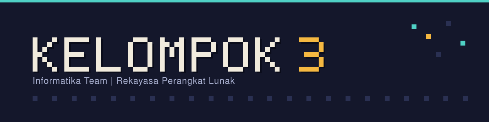

 

 

[Player Select](#-player-select) · [Course](#-course-information) · [Project Profile](#-project-profile) · [Project Charter](#-project-charter) · [Mission](#-our-mission)

---

# 🎮 PLAYER SELECT

### CHOOSE YOUR PLAYER

*Different personalities, one destination.*

<table>
<tr>
<td align="center" width="50%">

### PLAYER 01

### 🎀 NAZUA

`GITHUB: @nazua4868`

**NIM: 250504128**

`FEMALE PLAYER`

</td>
<td align="center" width="50%">

### PLAYER 02

### 🌸 GRACE ANASTASYA SIAHAAN

`GITHUB: @geyesanastasya05`

**NIM: 250504110**

`FEMALE PLAYER`

</td>
</tr>
<tr>
<td align="center" width="50%">

### PLAYER 03

### ⚡ MAULANA YOGA SYAHPUTRA

`GITHUB: @Nganggurr`

**NIM: 240504104**

`MALE PLAYER`

</td>
<td align="center" width="50%">

### PLAYER 04

### 🎮 MUHAMMAD AGIL RAMADHAN

`GITHUB: @agilramadhannn`

**NIM: 240504000**

`MALE PLAYER`

</td>
</tr>
<tr>
<td align="center" colspan="2">

### PLAYER 05

### 🚀 AL ICHSAN IRAWADI

**NIM: 240504120**

`MALE PLAYER`

</td>
</tr>
</table>

---

# 📚 COURSE INFORMATION

### REKAYASA PERANGKAT LUNAK

**DOSEN PENGAMPU**

### Cut Alna Fadhilla, S.Kom., M.Sc.

Program Studi Informatika · Fakultas Sains dan Teknologi · Universitas Samudra 2026

---

# 🧩 PROJECT PROFILE

### SMART CLASSROOM DIGITAL TWIN SYSTEM

*Versi digital dari ruang kuliah, tanpa perangkat keras tambahan.*

| ITEM | DETAIL |
|---|---|
| 🏷️ Nama Project | Smart Classroom Digital Twin System |
| 🖥️ Jenis | Aplikasi web (Digital Twin berbasis perangkat lunak) |
| 🏫 Domain | Manajemen fasilitas dan ruang kuliah kampus pintar |
| 🔁 Metodologi | Agile, kerangka kerja Scrum |
| 📍 Fase Saat Ini | Sprint 1: Analisis dan Desain Sistem |
| 🔌 Perangkat Keras | Tidak ada, seluruh data sensor disimulasikan oleh perangkat lunak |

### 📖 Ringkasan

Aplikasi web yang merepresentasikan ruang kuliah universitas secara digital. Pengguna dapat mengelola data ruang kelas, menyusun jadwal kuliah tanpa bentrok, memantau kondisi ruang yang disimulasikan, dan menganalisis pemakaian ruang melalui dashboard visual.

### 👥 Pengguna Sasaran

| AKTOR | KEBUTUHAN UTAMA |
|---|---|
| 🛡️ Administrator | Mengelola ruang kelas, jadwal, pengguna, dan konfigurasi sistem |
| 👨‍🏫 Dosen | Melihat ruang dan jadwal tersedia, kapasitas, serta status fasilitas virtual |
| 🏢 Pengelola Fasilitas Kampus | Memantau okupansi, kondisi ruang, dan analitik pemakaian |

### ⭐ Fitur Utama

| FITUR | DESKRIPSI |
|---|---|
| 🏫 Classroom Management | Profil ruang, kapasitas, dan fasilitas virtual (lampu, AC, proyektor) |
| 📅 Schedule Management | Penjadwalan kuliah dengan validasi bentrok otomatis |
| 🗺️ Digital Twin Overview | Tampilan interaktif 2D/kartu untuk status ruang kelas |
| 👥 Occupancy Simulation | Simulasi jumlah peserta dan status kosong/terisi |
| 📊 Utilization Analytics | Dashboard jam sibuk dan tingkat pemakaian ruang |
| 🔐 Role-Based Access | Hak akses berbeda untuk setiap aktor |

### 🛠️ Teknologi yang Direncanakan

| LAYER | TEKNOLOGI |
|---|---|
| Frontend | React / Next.js (TypeScript), Tailwind CSS, Recharts |
| Backend | Node.js, Express.js (TypeScript), REST API, JWT |
| Database | PostgreSQL, Prisma ORM |
| DevOps | Docker, Docker Compose, Nginx, GitHub Actions |

---

# 📜 PROJECT CHARTER

*Dokumen kesepakatan awal project.*

### 1️⃣ Gambaran Umum

| ITEM | DETAIL |
|---|---|
| Judul Project | Smart Classroom Digital Twin System |
| Sponsor | Cut Alna Fadhilla, S.Kom., M.Sc. (Dosen Rekayasa Perangkat Lunak) |
| Tim | Kelompok 3 (5 anggota) |
| Project Manager | Ditentukan oleh tim |
| Pendekatan | Agile Scrum, 4 sprint |

### 2️⃣ Justifikasi

Data ruang kelas, kapasitas, dan jadwal di banyak kampus tersimpan terpisah, misalnya di spreadsheet. Akibatnya jadwal bisa bentrok, kapasitas ruang tidak sesuai jumlah mahasiswa, dan pemakaian ruang sulit dipantau. Digital Twin berbasis perangkat lunak memberi gambaran terpadu, visual, dan dapat dianalisis tanpa biaya infrastruktur IoT.

### 3️⃣ Tujuan Project

| NO | TUJUAN | UKURAN KEBERHASILAN |
|:-:|---|---|
| 1 | Memusatkan data ruang kelas | Profil ruang, kapasitas, dan fasilitas dapat dikelola dalam satu sistem |
| 2 | Mencegah jadwal bentrok | Jadwal yang tumpang tindih pada ruang yang sama ditolak oleh validasi |
| 3 | Menyediakan pemantauan simulasi | Okupansi dan status fasilitas tampil di Digital Twin Overview |
| 4 | Mendukung keputusan lewat analitik | Dashboard pemakaian dan jam sibuk tersedia |
| 5 | Menerapkan praktik rekayasa perangkat lunak | Dokumen analisis dan desain Sprint 1 selesai |

### 4️⃣ Ruang Lingkup

| ✅ DALAM LINGKUP | ❌ DI LUAR LINGKUP |
|---|---|
| Aplikasi web untuk ruang kelas, jadwal, dan Digital Twin | Integrasi sensor IoT fisik |
| Akses berbasis peran: Admin, Dosen, Pengelola Fasilitas | CCTV, kamera, mikrokontroler, perangkat tertanam |
| Simulasi okupansi dan status fasilitas virtual | Pengukuran kondisi ruang secara fisik |
| Overview interaktif dan analitik pemakaian | Aplikasi mobile native |

### 5️⃣ Deliverable per Sprint

| SPRINT | FOKUS | HASIL | STATUS |
|---|---|---|---|
| **Sprint 1** | Analisis & Desain | User Story, Activity Diagram, Flowchart, API Spec, Function Point, Wireframe, Deployment | 🔄 Berjalan |
| **Sprint 2** | Backend & Autentikasi | Skema database, JWT, RBAC, REST API ruang & jadwal | 🔒 Direncanakan |
| **Sprint 3** | Digital Twin & Simulasi | Overview interaktif, API & UI simulasi, integrasi frontend | 🔒 Direncanakan |
| **Sprint 4** | Analitik & Deployment | Dashboard analitik, pengujian end-to-end, Docker, CI/CD | 🔒 Direncanakan |

### 6️⃣ Stakeholder

| STAKEHOLDER | KEPENTINGAN |
|---|---|
| Dosen pengampu | Menilai proses, dokumentasi, dan hasil akhir |
| Tim pengembang (Kelompok 3) | Merancang, membangun, menguji, dan mendokumentasikan sistem |
| Administrator | Mengoperasikan dan mengonfigurasi sistem |
| Dosen (pengguna) | Memakai informasi jadwal dan ruang |
| Pengelola Fasilitas Kampus | Memakai pemantauan dan analitik untuk perencanaan |

### 7️⃣ Sumber Daya

| SUMBER DAYA | DETAIL |
|---|---|
| Sumber daya manusia | 5 anggota tim |
| Alat | GitHub, Docker, GitHub Actions |
| Anggaran | Tidak ada anggaran dana, memakai perangkat gratis dan open source |

### 8️⃣ Risiko dan Mitigasi

| RISIKO | DAMPAK | MITIGASI |
|---|---|---|
| Lingkup membesar melebihi waktu | Fitur tidak selesai | Prioritaskan fitur inti per sprint, hardware tetap di luar lingkup |
| Kontribusi anggota tidak merata | Keterlambatan dan kualitas turun | Bagi tugas tiap sprint, wajibkan commit semua anggota |
| Belum menguasai teknologi | Pengembangan lambat | Belajar bersama, kerja berpasangan pada bagian sulit |
| Integrasi frontend dan backend bermasalah | Pengerjaan ulang | Sepakati spesifikasi API sejak Sprint 1 |
| Data simulasi terasa tidak realistis | Nilai Digital Twin lemah | Buat pola okupansi berdasarkan jadwal dan kapasitas |

### 9️⃣ Asumsi dan Batasan

**Asumsi**
- Semua anggota memiliki akses GitHub dan alat pengembangan.
- Data ruang dan jadwal adalah data contoh atau simulasi.
- Dosen pengampu tersedia untuk reviu di akhir tiap sprint.

**Batasan**
- Sistem tidak boleh bergantung pada perangkat keras atau IoT.
- Pengerjaan mengikuti jadwal sprint mata kuliah.
- Hanya memakai perangkat gratis dan open source.

### 🔟 Kriteria Keberhasilan

- Dokumen Sprint 1 lengkap dan konsisten satu sama lain.
- Setiap anggota memiliki commit yang dapat diverifikasi di repository.
- Sistem akhir mendukung pengelolaan ruang, jadwal tanpa bentrok, simulasi okupansi, dan analitik pemakaian.
- Sistem dapat dijalankan lewat alur deployment berbasis container yang terdokumentasi.

---

# ⚡ TEAM POWER-UPS

| POWER-UP | DESCRIPTION |
|---|---|
| 💡 Creativity | Mengembangkan ide kreatif |
| 🤝 Teamwork | Kerja sama kelompok |
| 🚀 Innovation | Menciptakan inovasi |
| 🧠 Problem Solving | Menyelesaikan masalah |
| 📖 Knowledge | Belajar bersama |

---

# 💻 LANGUAGES & TECHNOLOGIES

  

---

# 🏆 OUR MISSION

### DESIGN • DEVELOP • INNOVATE

Belajar bersama, bekerja sama, dan mengembangkan
kemampuan dalam bidang Rekayasa Perangkat Lunak.

 

| MISSION | STATUS |
|---|---|
| Team Formation | ✅ COMPLETED |
| Project Planning | 🔄 IN PROGRESS |
| System Analysis | 🔄 IN PROGRESS |
| Development | 🔒 UPCOMING |

 

### "FIVE MINDS, ONE MISSION."

**INFORMATIKA TEAM © 2026**

