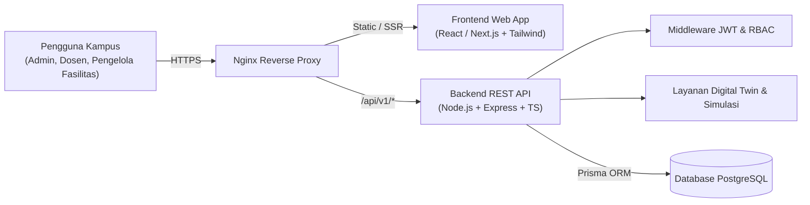

# Smart Classroom Digital Twin System
### Sistem Kembaran Digital Ruang Kelas Pintar

## Deskripsi Proyek

**Smart Classroom Digital Twin System** adalah proyek rekayasa perangkat lunak berbasis web yang dirancang untuk membuat representasi digital (Digital Twin) dari ruang kelas perkuliahan di universitas.

Sistem ini memungkinkan administrator kampus, dosen, dan pengelola fasilitas untuk mengelola inventaris ruang kelas, mengatur kapasitas tempat duduk, menyusun jadwal perkuliahan, memantau kondisi ruang kelas secara simulasi, serta menganalisis pemanfaatan ruangan melalui dasbor visual yang interaktif.

Berbeda dengan platform gedung pintar yang bergantung pada perangkat keras, sistem ini sepenuhnya beroperasi sebagai **Digital Twin berbasis perangkat lunak**. Kondisi lingkungan ruang kelas, tingkat keterisian, dan status kegiatan perkuliahan direpresentasikan secara digital melalui data yang dikelola dan disimulasikan oleh aplikasi.

---

## 👥 Profil Kelompok

### Anggota Kelompok Kami

<div align="center">

<table>
<tr>
<td align="center" width="50%">

<h3>NAZUA</h3>
<p>250504128</p>
<p>ANGGOTA KELOMPOK 01</p>
</td>

<td align="center" width="50%">

<h3>GRACE ANASTASYA SIAHAAN</h3>
<p>250504110</p>
<p>ANGGOTA KELOMPOK 02</p>
</td>
</tr>

<tr>
<td align="center" width="50%">

<h3>MAULANA YOGA SYAHPUTRA</h3>
<p>240504104</p>
<p>ANGGOTA KELOMPOK 03</p>
</td>

<td align="center" width="50%">

<h3>MUHAMMAD AGIL RAMADHAN</h3>
<p>240504112</p>
<p>ANGGOTA KELOMPOK 04</p>
</td>
</tr>
</table>

</div>

---

## Latar Belakang

Universitas sering menghadapi berbagai kendala dalam mengelola alokasi ruang kelas, mencegah bentrokan jadwal perkuliahan, memantau penggunaan ruangan, serta menilai kesesuaian kapasitas ruang dengan jumlah mahasiswa.

Sistem pengelolaan yang masih menggunakan spreadsheet atau penjadwalan statis memiliki keterbatasan dalam menampilkan informasi secara visual dan menyediakan analisis yang memadai. Hal ini menyulitkan pihak kampus untuk memperoleh informasi yang akurat dan terpusat mengenai ketersediaan serta kondisi operasional ruang kelas.

Dengan menerapkan konsep **Digital Twin** pada tingkat perangkat lunak, ruang kelas fisik dapat dimodelkan secara digital melalui atribut yang terstruktur, kondisi fasilitas virtual, simulasi jumlah penghuni, serta pemetaan jadwal perkuliahan.

Dengan demikian, sistem dapat memberikan pengalaman pengelolaan kampus pintar tanpa memerlukan infrastruktur perangkat IoT yang mahal.

---

## Rumusan Masalah

1. **Data Ruang Kelas yang Terpisah:** Informasi mengenai kapasitas ruangan, fasilitas yang tersedia, dan jadwal perkuliahan sering disimpan secara terpisah sehingga menyebabkan ketidakefisienan dalam kegiatan akademik.

2. **Kurangnya Pemantauan Kondisi Secara Visual:** Pihak terkait belum dapat melihat kondisi operasional dan tingkat keterisian ruang kelas secara mudah melalui satu representasi digital yang terpusat.

3. **Bentrok Jadwal dan Kurangnya Pemanfaatan Ruangan:** Penentuan ruang kelas secara manual meningkatkan risiko jadwal perkuliahan yang bertabrakan serta ketidaksesuaian antara jumlah mahasiswa dan kapasitas ruangan.

4. **Keterbatasan Informasi Analisis:** Pengelola fasilitas kampus belum memiliki informasi statistik dan visualisasi yang memadai mengenai jam perkuliahan tersibuk serta tingkat pemanfaatan ruang kelas untuk mendukung pengambilan keputusan.

---

## Tujuan Proyek

- Mengembangkan sistem Digital Twin berbasis perangkat lunak yang terpusat untuk merepresentasikan ruang kelas universitas secara digital.
- Menyediakan pengelolaan profil ruang kelas, kapasitas, fasilitas virtual, dan jadwal perkuliahan dengan validasi bentrok jadwal.
- Memungkinkan pemantauan kondisi ruang kelas dan jumlah penghuninya secara simulasi melalui perangkat lunak.
- Menyediakan analisis pemanfaatan ruangan dan dasbor visual interaktif untuk membantu pengambilan keputusan akademik dan pengelolaan fasilitas.
- Menerapkan metode pengembangan Agile Scrum secara terstruktur, dimulai dengan analisis dan perancangan sistem secara menyeluruh pada Sprint 1.

---

## Ruang Lingkup Proyek

### Fitur yang Termasuk dalam Proyek (In Scope)

- Aplikasi berbasis web untuk pengelolaan ruang kelas, jadwal perkuliahan, simulasi keterisian, dan manajemen Digital Twin.
- Sistem Hak Akses Berbasis Peran (RBAC) untuk tiga pengguna utama:
  - Administrator.
  - Dosen.
  - Pengelola Fasilitas Kampus.
- Simulasi keterisian ruang kelas dan kondisi fasilitas virtual, seperti:
  - Status ruangan kosong atau terisi.
  - Jumlah peserta yang disimulasikan.
  - Status lampu virtual.
  - Status AC virtual.
  - Status proyektor virtual.
- Tampilan Digital Twin ruang kelas berbasis visual 2D atau kartu interaktif.
- Analisis dan visualisasi pemanfaatan ruang kelas.

### Batasan Proyek (Out of Scope)

- **Tidak Menggunakan Perangkat Keras atau Integrasi IoT:** Sistem tidak terhubung dengan sensor IoT fisik, kamera CCTV atau pengawasan, mikrokontroler, maupun perangkat keras tertanam.
- Seluruh parameter yang menyerupai sensor dan metrik keterisian ruangan dihasilkan serta dikelola melalui simulasi perangkat lunak dan pembaruan data oleh pengguna aplikasi.

---

## Metodologi Pengembangan (Scrum)

Proyek ini menggunakan metodologi **Agile dengan kerangka kerja Scrum**.

Pengembangan sistem dibagi menjadi beberapa tahapan Sprint yang memiliki tujuan, daftar pekerjaan (Product Backlog), evaluasi, dan hasil akhir yang telah ditentukan.

Metode ini diterapkan untuk memastikan proses pengembangan berjalan secara bertahap, terstruktur, dan tetap sesuai dengan kebutuhan pengguna serta kualitas arsitektur sistem.

---

## Rencana Pengembangan Sprint

| Sprint | Fokus Pengembangan | Hasil yang Diharapkan | Status |
| :--- | :--- | :--- | :--- |
| **Sprint 1** | **Analisis dan Perancangan Sistem** | User Stories, Activity Diagram, Flowchart, Spesifikasi API, Function Point Analysis, Wireframe UI/UX, dan Arsitektur Deployment | **Selesai (Fokus Saat Ini)** |
| **Sprint 2** | **Backend Inti dan Autentikasi** | Migrasi skema database, autentikasi JWT, RBAC, API pengelolaan ruang kelas dan jadwal perkuliahan | Direncanakan |
| **Sprint 3** | **Digital Twin dan Mesin Simulasi** | Tampilan Digital Twin interaktif, API dan UI simulasi keterisian, integrasi frontend untuk modul ruang kelas dan jadwal | Direncanakan |
| **Sprint 4** | **Analitik, Pengujian, dan Deployment** | Dasbor analisis pemanfaatan ruangan dan jam tersibuk, pengujian End-to-End, Dockerisasi, CI/CD, dan deployment produksi | Direncanakan |

---

## Dokumentasi Sprint 1

Seluruh dokumen analisis dan perancangan sistem pada Sprint 1 disimpan di dalam direktori `docs/`.

| Dokumen | Deskripsi | Lokasi |
| :--- | :--- | :--- |
| **User Stories** | Kebutuhan fungsional sistem berdasarkan fitur dan aktor beserta kriteria penerimaan | [`docs/USER-STORY.md`](docs/USER-STORY.md) |
| **Activity Diagram** | Diagram aktivitas Swimlane yang menggambarkan interaksi Administrator, Dosen, dan Sistem | [`docs/ACTIVITY-DIAGRAM.md`](docs/ACTIVITY-DIAGRAM.md) |
| **System Flowchart** | Alur navigasi utama pengguna dan proses pengelolaan ruang kelas secara terperinci | [`docs/FLOWCHART.md`](docs/FLOWCHART.md) |
| **API Specification** | Rancangan endpoint RESTful API, payload, kode status, dan struktur respons | [`docs/API-SPEC.md`](docs/API-SPEC.md) |
| **Function Point Analysis** | Estimasi ukuran perangkat lunak menggunakan metrik IFPUG Function Point (UFP, VAF, Final FP) | [`docs/FUNCTION-POINT.md`](docs/FUNCTION-POINT.md) |
| **UI/UX Wireframes** | Desain antarmuka Smart Campus, tata letak, komponen, dan alur navigasi | [`docs/UI-UX-WIREFRAME.md`](docs/UI-UX-WIREFRAME.md) |
| **Deployment Design** | Kebutuhan sistem, teknologi yang digunakan, arsitektur container, dan alur deployment | [`docs/DEPLOYMENT.md`](docs/DEPLOYMENT.md) |

---

## Teknologi yang Digunakan

### Frontend
- React.js.
- Next.js.
- TypeScript.
- Tailwind CSS.
- Recharts.
- Lucide Icons.

### Backend
- Node.js.
- Express.js.
- TypeScript.
- RESTful API.
- JWT Authentication.

### Database dan ORM
- PostgreSQL.
- Prisma ORM.

### Infrastruktur dan DevOps
- Docker.
- Docker Compose.
- Nginx Reverse Proxy.
- GitHub Actions.

---

## Gambaran Arsitektur Sistem

Aplikasi dirancang menggunakan arsitektur web client-server yang terpisah (decoupled), serta menggunakan container agar proses deployment dapat berjalan secara konsisten di berbagai lingkungan.



---

## Struktur Repository

```text
smart-classroom-digital-twin/
│
├── docs/
│   │
│   ├── images/
│   │   ├── nazua.png
│   │   ├── grace.png
│   │   ├── maulana.png
│   │   └── agil.png
│   │
│   ├── ACTIVITY-DIAGRAM.md
│   ├── API-SPEC.md
│   ├── DEPLOYMENT.md
│   ├── FLOWCHART.md
│   ├── FUNCTION-POINT.md
│   ├── UI-UX-WIREFRAME.md
│   └── USER-STORY.md
│
├── README.md
│
└── (src/ akan dibuat pada Sprint 2)
```

---

## Status Pengembangan

**Tahapan Saat Ini:** `Sprint 1 – Analisis dan Perancangan Sistem`

Dokumentasi Sprint 1 telah diselesaikan sebagai dasar arsitektur dan analisis untuk proyek **Smart Classroom Digital Twin System**.

Implementasi kode sumber aplikasi, termasuk Backend API, migrasi database, serta antarmuka Frontend, direncanakan akan dimulai pada **Sprint 2**.

---

## Penutup

Smart Classroom Digital Twin System diharapkan dapat menjadi solusi digital untuk membantu perguruan tinggi dalam mengelola ruang kelas secara lebih terstruktur, efisien, dan interaktif.

Dengan memanfaatkan konsep Digital Twin berbasis perangkat lunak, sistem ini dapat memberikan gambaran kondisi ruang kelas secara digital, membantu mengurangi bentrok jadwal, serta menyediakan informasi analisis pemanfaatan ruangan untuk mendukung pengelolaan fasilitas kampus yang lebih baik.

---
