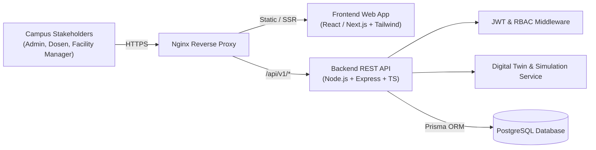

# Smart Classroom Digital Twin System

## Project Description
**Smart Classroom Digital Twin System** is a web-based software engineering project designed to create a digital representation (Digital Twin) of university lecture classrooms. The system enables campus administrators, lecturers, and facility managers to manage classroom inventories, configure seating capacities, organize academic schedules, monitor simulated classroom conditions, and analyze space utilization through an interactive visual dashboard.

Unlike hardware-dependent smart building platforms, this system operates purely as a **software-based Digital Twin**. Classroom environmental conditions, occupancy levels, and academic session states are represented digitally and driven by application-managed and simulated data models.

---

## Background
Universities frequently face challenges in managing classroom allocations, preventing schedule conflicts, tracking actual room utilization, and assessing whether room capacities match lecture needs. Traditional spreadsheet-based or static scheduling systems lack visual spatial context and analytical capabilities, making it difficult for stakeholders to obtain an accurate, unified view of campus classroom availability and operational conditions.

By adopting the **Digital Twin** paradigm at the software level, physical classrooms can be modeled digitally with structured attributes, virtual facility states, occupancy simulations, and real-time schedule mappings—providing a modern smart campus management experience without requiring costly physical IoT infrastructure.

---

## Problem Statement
1. **Fragmented Classroom Data:** Information regarding room capacities, available facilities, and schedules is often stored separately, causing inefficiencies in academic operations.
2. **Lack of Visual Condition Monitoring:** Stakeholders cannot easily inspect the operational status or occupancy utilization of classrooms in a unified digital representation.
3. **Schedule Conflicts and Underutilization:** Manual room assignment increases the risk of overlapping lecture schedules and mismatches between class sizes and room capacities.
4. **Limited Analytical Insights:** Campus facility managers lack aggregated metrics and visual analytics on peak lecture hours and classroom utilization rates to support data-driven planning.

---

## Objectives
- Develop a centralized software-based Digital Twin representation for university classrooms.
- Provide structured management for classroom profiles, capacities, virtual facilities, and lecture schedules with conflict validation.
- Enable real-time software-simulated monitoring of classroom occupancy and room conditions.
- Deliver utilization analytics and interactive visual dashboards to support academic and facility decision-making.
- Apply disciplined Agile Scrum engineering practices, beginning with comprehensive system analysis and design in Sprint 1.

---

## Project Scope
### In Scope
- Web-based application for classroom, schedule, occupancy simulation, and Digital Twin management.
- Role-Based Access Control (RBAC) for three core actors: **Administrator**, **Lecturer (Dosen)**, and **Campus Facility Manager (Pengelola Fasilitas Kampus)**.
- Software-simulated classroom occupancy and virtual facility states (e.g., vacant/occupied status, simulated attendee count, virtual lighting/AC/projector states).
- Interactive 2D/card-based Digital Twin classroom overview and utilization analytics.

### Out of Scope (System Constraints)
- **No Physical Hardware or IoT Integration:** The system does not connect to physical IoT sensors, CCTV/surveillance cameras, microcontrollers, or embedded hardware devices.
- All sensor-like parameters and occupancy metrics are generated and maintained through software simulation and user-driven application updates.

---

## Development Methodology (Scrum)
This project follows the **Agile methodology using the Scrum framework**. Development is divided into iterative Sprints with defined goals, backlog items, reviews, and deliverables to ensure continuous alignment with stakeholder needs and high architectural quality.

---

## Sprint Roadmap

| Sprint | Focus Area | Key Deliverables | Status |
| :--- | :--- | :--- | :--- |
| **Sprint 1** | **System Analysis & Design** | User Stories, Activity Diagrams, Flowcharts, API Specification, Function Point Analysis, UI/UX Wireframes, Deployment Architecture | **Completed (Current Focus)** |
| **Sprint 2** | **Core Backend & Authentication** | Database schema migration, JWT Authentication, RBAC, Classroom & Schedule Management REST APIs | Planned |
| **Sprint 3** | **Digital Twin & Simulation Engine** | Interactive Digital Twin Overview UI, Occupancy Simulation API & UI, Frontend integration for Classroom & Schedule modules | Planned |
| **Sprint 4** | **Analytics, Testing & Deployment** | Utilization & Peak-Hour Analytics Dashboard, End-to-End testing, Dockerization, CI/CD & Production Deployment | Planned |

---

## Sprint 1 Documentation
All Sprint 1 system analysis and design artifacts are located in the `docs/` directory:

| Document | Description | Link |
| :--- | :--- | :--- |
| **User Stories** | Functional requirements grouped by system features and actors with acceptance criteria | [`docs/USER-STORY.md`](docs/USER-STORY.md) |
| **Activity Diagram** | Swimlane activity diagrams modeling interactions between Administrator, Dosen, and System | [`docs/ACTIVITY-DIAGRAM.md`](docs/ACTIVITY-DIAGRAM.md) |
| **System Flowchart** | Main user navigation flow and detailed classroom management process flow | [`docs/FLOWCHART.md`](docs/FLOWCHART.md) |
| **API Specification** | Planned RESTful API endpoints, payloads, status codes, and response structures | [`docs/API-SPEC.md`](docs/API-SPEC.md) |
| **Function Point Analysis** | Software size estimation using IFPUG Function Point metrics (UFP, VAF, Final FP) | [`docs/FUNCTION-POINT.md`](docs/FUNCTION-POINT.md) |
| **UI/UX Wireframes** | Modern Smart Campus interface designs, layouts, components, and navigation flows | [`docs/UI-UX-WIREFRAME.md`](docs/UI-UX-WIREFRAME.md) |
| **Deployment Design** | System requirements, technology stack, container architecture, and deployment workflow | [`docs/DEPLOYMENT.md`](docs/DEPLOYMENT.md) |

---

## Technology Stack
- **Frontend:** React.js (Next.js / TypeScript), Tailwind CSS, Recharts, Lucide Icons
- **Backend:** Node.js, Express.js (TypeScript), RESTful API, JWT Authentication
- **Database & ORM:** PostgreSQL, Prisma ORM
- **Infrastructure & DevOps:** Docker, Docker Compose, Nginx Reverse Proxy, GitHub Actions

---

## System Architecture Overview
The application is designed around a decoupled client-server web architecture, containerized for consistent deployment across environments.



---

## Repository Structure

```text
smart-classroom-digital-twin/
├── docs/
│   ├── ACTIVITY-DIAGRAM.md
│   ├── API-SPEC.md
│   ├── DEPLOYMENT.md
│   ├── FLOWCHART.md
│   ├── FUNCTION-POINT.md
│   ├── UI-UX-WIREFRAME.md
│   └── USER-STORY.md
├── README.md
└── (src/ will be initialized in Sprint 2)
```

---

## Development Status
**Current Phase:** `Sprint 1 – System Analysis and Design`

Sprint 1 documentation has been completed as the architectural and analytical foundation of the **Smart Classroom Digital Twin System**. Application source code implementation (backend APIs, database migrations, and frontend interfaces) is scheduled to begin in **Sprint 2**.
