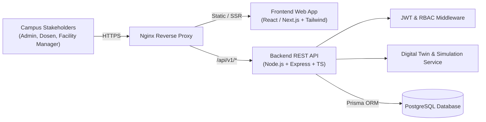

<div align="center">


# Smart Classroom Digital Twin System

**Project Kelompok 3 — Rekayasa Perangkat Lunak**


**Program Studi Informatika · Fakultas Sains dan Teknologi · Universitas Samudra 2026**

</div>

---

## Table of Contents

1. [Team Profile](#1-team-profile)
2. [Project Profile](#2-project-profile)
3. [Project Charter](#3-project-charter)
4. [Project Description](#4-project-description)
5. [Background and Problem Statement](#5-background-and-problem-statement)
6. [Objectives and Scope](#6-objectives-and-scope)
7. [Development Methodology and Sprint Roadmap](#7-development-methodology-and-sprint-roadmap)
8. [Sprint 1 Documentation](#8-sprint-1-documentation)
9. [Technology Stack and Architecture](#9-technology-stack-and-architecture)
10. [Repository Structure and Status](#10-repository-structure-and-status)

---

## 1. Team Profile

| Item | Detail |
| :--- | :--- |
| **Group Name** | Kelompok 3 |
| **Course** | Rekayasa Perangkat Lunak |
| **Lecturer** | Cut Alna Fadhilla, S.Kom., M.Sc |
| **Study Program** | Informatika, Fakultas Sains dan Teknologi |
| **Institution** | Universitas Samudra |

### Team Members

| No | Name | Student ID (NIM) |
| :-: | :--- | :--- |
| 1 | Muhammad Agil Ramadhan | 240504000 |
| 2 | Maulana Yoga Syahputra | 240504000 |
| 3 | Grace Anastasya Siahaan | 250504000 |
| 4 | Nazua | 250504000 |
| 5 | Al Ichsan Irawadi | 240504120 |

---

## 2. Project Profile

| Item | Detail |
| :--- | :--- |
| **Project Name** | Smart Classroom Digital Twin System |
| **Project Type** | Web-based application (software-only Digital Twin) |
| **Domain** | Smart campus and academic facility management |
| **Methodology** | Agile, Scrum framework |
| **Current Phase** | Sprint 1: System Analysis and Design |
| **Hardware Dependency** | None (all sensor-like data is simulated by software) |

### Summary

A web application that models university lecture classrooms as digital representations. It lets stakeholders manage classroom data, organize lecture schedules without conflicts, observe simulated room conditions, and analyze how classrooms are used.

### Target Users

| Actor | Main Needs |
| :--- | :--- |
| **Administrator** | Manage classrooms, schedules, users, and system configuration |
| **Lecturer (Dosen)** | View available rooms and schedules, check room capacity and virtual facility status |
| **Campus Facility Manager** | Monitor occupancy, room conditions, and utilization analytics |

### Key Features

| Feature | Description |
| :--- | :--- |
| **Classroom Management** | Classroom profiles, capacities, and virtual facilities (lighting, AC, projector) |
| **Schedule Management** | Lecture scheduling with automatic conflict validation |
| **Digital Twin Overview** | Interactive 2D/card-based view of classroom status |
| **Occupancy Simulation** | Simulated attendee counts and vacant/occupied states |
| **Utilization Analytics** | Dashboard for peak-hour and room-usage metrics |
| **Role-Based Access Control** | Separate access rights for each actor |

---

## 3. Project Charter

### 3.1 Project Overview

| Item | Detail |
| :--- | :--- |
| **Project Title** | Smart Classroom Digital Twin System |
| **Project Sponsor** | Cut Alna Fadhilla, S.Kom., M.Sc (Lecturer, Rekayasa Perangkat Lunak) |
| **Project Team** | Kelompok 3 (5 members, see [Team Profile](#1-team-profile)) |
| **Project Manager** | To be determined by the team |
| **Approach** | Agile Scrum, 4 sprints |

### 3.2 Business Justification

Universities often manage classroom data, capacities, and schedules in separate places such as spreadsheets. This causes schedule conflicts, mismatches between class size and room capacity, and no clear view of how rooms are used. A software-based Digital Twin gives a unified, visual, and analyzable view of classrooms without the cost of physical IoT infrastructure.

### 3.3 Project Goals

| No | Goal | Success Measure |
| :-: | :--- | :--- |
| 1 | Centralize classroom data in one digital representation | Classroom profiles, capacities, and virtual facilities manageable in one system |
| 2 | Prevent schedule conflicts | Overlapping schedules for the same room are rejected by validation |
| 3 | Provide simulated real-time monitoring | Occupancy and facility states visible on the Digital Twin overview |
| 4 | Support decision-making with analytics | Utilization and peak-hour dashboard available |
| 5 | Apply disciplined software engineering practice | Complete Sprint 1 analysis and design documents delivered |

### 3.4 Scope

| In Scope | Out of Scope |
| :--- | :--- |
| Web application for classroom, schedule, and Digital Twin management | Integration with physical IoT sensors |
| Role-based access for Administrator, Lecturer, and Facility Manager | CCTV, cameras, microcontrollers, or embedded hardware |
| Software-simulated occupancy and virtual facility states | Real physical measurement of room conditions |
| Interactive overview and utilization analytics | Mobile native applications |

### 3.5 Deliverables

| Sprint | Deliverables |
| :--- | :--- |
| **Sprint 1** | User Stories, Activity Diagrams, Flowcharts, API Specification, Function Point Analysis, UI/UX Wireframes, Deployment Design |
| **Sprint 2** | Database schema, JWT authentication, RBAC, Classroom and Schedule REST APIs |
| **Sprint 3** | Digital Twin overview UI, Occupancy Simulation API and UI, frontend integration |
| **Sprint 4** | Analytics dashboard, end-to-end testing, Dockerization, CI/CD, deployment |

### 3.6 Stakeholders

| Stakeholder | Interest |
| :--- | :--- |
| **Lecturer of the course** | Evaluates the process, documentation, and final result |
| **Development team (Kelompok 3)** | Designs, builds, tests, and documents the system |
| **Administrator** | Operates and configures the system |
| **Lecturer (Dosen) users** | Use schedule and classroom information |
| **Campus Facility Manager** | Uses monitoring and analytics for planning |

### 3.7 Milestones

| Milestone | Target Outcome | Status |
| :--- | :--- | :--- |
| **M1: Analysis and Design** | Sprint 1 documents completed | Completed |
| **M2: Core Backend** | Authentication, RBAC, core REST APIs working | Planned |
| **M3: Digital Twin and Simulation** | Interactive overview and simulation running | Planned |
| **M4: Analytics and Deployment** | Dashboard, testing, and deployment complete | Planned |

### 3.8 Resources

| Resource | Detail |
| :--- | :--- |
| **Human resources** | 5 team members |
| **Tools** | GitHub (version control and collaboration), Docker, GitHub Actions |
| **Technology** | Next.js, Tailwind CSS, Node.js, Express.js, PostgreSQL, Prisma |
| **Budget** | No monetary budget; academic project using free and open-source tools |

### 3.9 Risks and Mitigation

| Risk | Impact | Mitigation |
| :--- | :--- | :--- |
| Scope grows beyond available time | Features unfinished | Prioritize core features per sprint, keep hardware integration out of scope |
| Uneven contribution among members | Delays and quality gaps | Divide tasks per sprint, require commits from every member |
| Unfamiliarity with the technology stack | Slower development | Share learning resources, pair on difficult tasks |
| Integration problems between frontend and backend | Rework | Agree on the API specification early (Sprint 1) |
| Simulated data feels unrealistic | Weak Digital Twin value | Use realistic occupancy patterns based on schedules and capacity |

### 3.10 Assumptions and Constraints

**Assumptions**
- All team members have access to GitHub and the required development tools.
- Classroom and schedule data used in the system is sample or simulated data.
- The course lecturer is available for review and feedback at the end of each sprint.

**Constraints**
- The system must not depend on physical hardware or IoT devices.
- Delivery follows the sprint schedule of the Rekayasa Perangkat Lunak course.
- Only free and open-source tools are used.

### 3.11 Success Criteria

- Sprint 1 documents are complete and consistent with each other.
- Every team member has verifiable commits in the repository.
- The final system supports classroom management, conflict-free scheduling, occupancy simulation, and utilization analytics.
- The system can be deployed through a documented container-based workflow.

---

## 4. Project Description

**Smart Classroom Digital Twin System** is a web-based software engineering project designed to create a digital representation (Digital Twin) of university lecture classrooms. The system enables campus administrators, lecturers, and facility managers to manage classroom inventories, configure seating capacities, organize academic schedules, monitor simulated classroom conditions, and analyze space utilization through an interactive visual dashboard.

Unlike hardware-dependent smart building platforms, this system operates purely as a **software-based Digital Twin**. Classroom environmental conditions, occupancy levels, and academic session states are represented digitally and driven by application-managed and simulated data models.

---

## 5. Background and Problem Statement

### Background

Universities frequently face challenges in managing classroom allocations, preventing schedule conflicts, tracking actual room utilization, and assessing whether room capacities match lecture needs. Traditional spreadsheet-based or static scheduling systems lack visual spatial context and analytical capabilities, making it difficult for stakeholders to obtain an accurate, unified view of campus classroom availability and operational conditions.

By adopting the **Digital Twin** paradigm at the software level, physical classrooms can be modeled digitally with structured attributes, virtual facility states, occupancy simulations, and real-time schedule mappings, providing a modern smart campus management experience without requiring costly physical IoT infrastructure.

### Problem Statement

1. **Fragmented Classroom Data:** Information regarding room capacities, available facilities, and schedules is often stored separately, causing inefficiencies in academic operations.
2. **Lack of Visual Condition Monitoring:** Stakeholders cannot easily inspect the operational status or occupancy utilization of classrooms in a unified digital representation.
3. **Schedule Conflicts and Underutilization:** Manual room assignment increases the risk of overlapping lecture schedules and mismatches between class sizes and room capacities.
4. **Limited Analytical Insights:** Campus facility managers lack aggregated metrics and visual analytics on peak lecture hours and classroom utilization rates to support data-driven planning.

---

## 6. Objectives and Scope

### Objectives

- Develop a centralized software-based Digital Twin representation for university classrooms.
- Provide structured management for classroom profiles, capacities, virtual facilities, and lecture schedules with conflict validation.
- Enable real-time software-simulated monitoring of classroom occupancy and room conditions.
- Deliver utilization analytics and interactive visual dashboards to support academic and facility decision-making.
- Apply disciplined Agile Scrum engineering practices, beginning with comprehensive system analysis and design in Sprint 1.

### In Scope

- Web-based application for classroom, schedule, occupancy simulation, and Digital Twin management.
- Role-Based Access Control (RBAC) for three core actors: **Administrator**, **Lecturer (Dosen)**, and **Campus Facility Manager (Pengelola Fasilitas Kampus)**.
- Software-simulated classroom occupancy and virtual facility states (e.g., vacant/occupied status, simulated attendee count, virtual lighting/AC/projector states).
- Interactive 2D/card-based Digital Twin classroom overview and utilization analytics.

### Out of Scope (System Constraints)

- **No Physical Hardware or IoT Integration:** The system does not connect to physical IoT sensors, CCTV/surveillance cameras, microcontrollers, or embedded hardware devices.
- All sensor-like parameters and occupancy metrics are generated and maintained through software simulation and user-driven application updates.

---

## 7. Development Methodology and Sprint Roadmap

This project follows the **Agile methodology using the Scrum framework**. Development is divided into iterative Sprints with defined goals, backlog items, reviews, and deliverables to ensure continuous alignment with stakeholder needs and high architectural quality.

| Sprint | Focus Area | Key Deliverables | Status |
| :--- | :--- | :--- | :--- |
| **Sprint 1** | **System Analysis & Design** | User Stories, Activity Diagrams, Flowcharts, API Specification, Function Point Analysis, UI/UX Wireframes, Deployment Architecture | **Completed (Current Focus)** |
| **Sprint 2** | **Core Backend & Authentication** | Database schema migration, JWT Authentication, RBAC, Classroom & Schedule Management REST APIs | Planned |
| **Sprint 3** | **Digital Twin & Simulation Engine** | Interactive Digital Twin Overview UI, Occupancy Simulation API & UI, Frontend integration for Classroom & Schedule modules | Planned |
| **Sprint 4** | **Analytics, Testing & Deployment** | Utilization & Peak-Hour Analytics Dashboard, End-to-End testing, Dockerization, CI/CD & Production Deployment | Planned |

---

## 8. Sprint 1 Documentation

All Sprint 1 system analysis and design artifacts are located in the `docs/` directory:

| Document | Description | Link |
| :--- | :--- | :--- |
| **User Stories** | Functional requirements grouped by system features and actors with acceptance criteria | [`docs/USER-STORY.md`](docs/USER-STORY.md) |
| **Activity Diagram** | Swimlane activity diagrams modeling interactions between Administrator, Dosen, and System | [`docs/ACTIVITY-DIAGRAM.md`](docs/ACTIVITY-DIAGRAM.md) |
| **System Flowchart** | Main user navigation flow and detailed classroom management process flow | [`docs/FLOWCHART.md`](docs/FLOWCHART.md) |
| **API Specification** | Planned RESTful API endpoints, payloads, status codes, and response structures | [`docs/API-SPEC.md`](docs/API-SPEC.md) |
| **Function Point Analysis** | Software size estimation using IFPUG Function Point metrics (UFP, VAF, Final FP) | [`docs/FUNCTION-POINT.md`](docs/FUNCTION-POINT.md) |
| **UI/UX Wireframes** | Modern Smart Campus interface designs, layouts, components, and navigation flows | [`docs/UI-UX-WIREFRAME.md`](docs/UI-UX-WIREFRAME.md) |
| **Deployment Design** | System requirements, technology stack, container architecture, and deployment workflow | [`docs/DEPLOYMENT.md`](docs/DEPLOYMENT.md) |

---

## 9. Technology Stack and Architecture

### Technology Stack

- **Frontend:** React.js (Next.js / TypeScript), Tailwind CSS, Recharts, Lucide Icons
- **Backend:** Node.js, Express.js (TypeScript), RESTful API, JWT Authentication
- **Database & ORM:** PostgreSQL, Prisma ORM
- **Infrastructure & DevOps:** Docker, Docker Compose, Nginx Reverse Proxy, GitHub Actions

### System Architecture Overview

The application is designed around a decoupled client-server web architecture, containerized for consistent deployment across environments.



---

## 10. Repository Structure and Status

```text
smart-classroom-digital-twin/
├── docs/
│   ├── ACTIVITY-DIAGRAM.md
│   ├── API-SPEC.md
│   ├── DEPLOYMENT.md
│   ├── FLOWCHART.md
│   ├── FUNCTION-POINT.md
│   ├── UI-UX-WIREFRAME.md
│   └── USER-STORY.md
├── README.md
└── (src/ will be initialized in Sprint 2)
```

### Development Status

**Current Phase:** `Sprint 1 – System Analysis and Design`

Sprint 1 documentation has been completed as the architectural and analytical foundation of the **Smart Classroom Digital Twin System**. Application source code implementation (backend APIs, database migrations, and frontend interfaces) is scheduled to begin in **Sprint 2**.

---

<div align="center">

**Kelompok 3 · Rekayasa Perangkat Lunak**
Dosen Pengampu: Cut Alna Fadhilla, S.Kom., M.Sc
Program Studi Informatika · Fakultas Sains dan Teknologi · Universitas Samudra 2026

</div>
