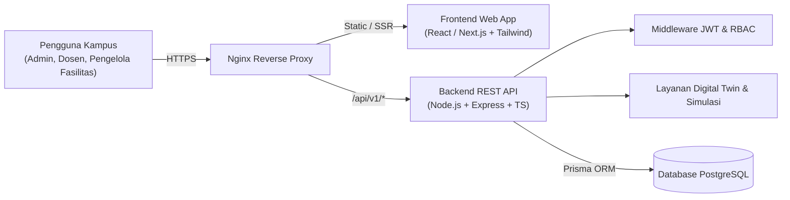

# SMART CLASSROOM DIGITAL TWIN SYSTEM
### Sistem Kembaran Digital Ruang Kelas Pintar

---

# 1. PROFIL KELOMPOK (TEAM PROFILE)

## Anggota Kelompok

<div align="center">

<table>
<tr>
<td align="center" width="50%">

<h3>NAZUA</h3>
<p>250504128</p>
<p>ANGGOTA KELOMPOK 01</p>
</td>

<td align="center" width="50%">

<h3>GRACE ANASTASYA SIAHAAN</h3>
<p>250504110</p>
<p>ANGGOTA KELOMPOK 02</p>
</td>
</tr>

<tr>
<td align="center" width="50%">

<h3>MAULANA YOGA SYAHPUTRA</h3>
<p>240504104</p>
<p>ANGGOTA KELOMPOK 03</p>
</td>

<td align="center" width="50%">

<h3>MUHAMMAD AGIL RAMADHAN</h3>
<p>240504112</p>
<p>ANGGOTA KELOMPOK 04</p>
</td>
</tr>
</table>

</div>

---

# 2. PROFIL PROYEK (PROJECT PROFILE)

## 2.1 Identitas Proyek

| Informasi | Keterangan |
| :--- | :--- |
| Nama Proyek | Smart Classroom Digital Twin System |
| Nama Indonesia | Sistem Kembaran Digital Ruang Kelas Pintar |
| Jenis Proyek | Rekayasa Perangkat Lunak |
| Kategori | Aplikasi Berbasis Web |
| Bidang | Pendidikan dan Teknologi Informasi |
| Metodologi | Agile Scrum |
| Tahapan Pengembangan | Sprint 1 – Analisis dan Perancangan Sistem |
| Platform | Web Application |
| Target Pengguna | Administrator, Dosen, Pengelola Fasilitas Kampus |

## 2.2 Deskripsi Proyek

**Smart Classroom Digital Twin System** adalah proyek rekayasa perangkat lunak berbasis web yang dirancang untuk membuat representasi digital (Digital Twin) dari ruang kelas perkuliahan di universitas.

Sistem ini memungkinkan administrator kampus, dosen, dan pengelola fasilitas untuk mengelola inventaris ruang kelas, mengatur kapasitas tempat duduk, menyusun jadwal perkuliahan, memantau kondisi ruang kelas secara simulasi, serta menganalisis pemanfaatan ruangan melalui dasbor visual yang interaktif.

Berbeda dengan platform gedung pintar yang bergantung pada perangkat keras, sistem ini sepenuhnya beroperasi sebagai **Digital Twin berbasis perangkat lunak**. Kondisi lingkungan ruang kelas, tingkat keterisian, dan status kegiatan perkuliahan direpresentasikan secara digital melalui data yang dikelola dan disimulasikan oleh aplikasi.

## 2.3 Latar Belakang

Universitas sering menghadapi berbagai kendala dalam mengelola alokasi ruang kelas, mencegah bentrokan jadwal perkuliahan, memantau penggunaan ruangan, serta menilai kesesuaian kapasitas ruang dengan jumlah mahasiswa.

Sistem pengelolaan yang masih menggunakan spreadsheet atau penjadwalan statis memiliki keterbatasan dalam menampilkan informasi secara visual dan menyediakan analisis yang memadai.

Hal ini menyulitkan pihak kampus untuk memperoleh informasi yang akurat dan terpusat mengenai ketersediaan serta kondisi operasional ruang kelas.

Dengan menerapkan konsep **Digital Twin** pada tingkat perangkat lunak, ruang kelas fisik dapat dimodelkan secara digital melalui atribut yang terstruktur, kondisi fasilitas virtual, simulasi jumlah penghuni, serta pemetaan jadwal perkuliahan.

Dengan demikian, sistem dapat memberikan pengalaman pengelolaan kampus pintar tanpa memerlukan infrastruktur perangkat IoT yang mahal.

## 2.4 Rumusan Masalah

1. **Data Ruang Kelas yang Terpisah:** Informasi mengenai kapasitas ruangan, fasilitas yang tersedia, dan jadwal perkuliahan sering disimpan secara terpisah sehingga menyebabkan ketidakefisienan dalam kegiatan akademik.

2. **Kurangnya Pemantauan Kondisi Secara Visual:** Pihak terkait belum dapat melihat kondisi operasional dan tingkat keterisian ruang kelas secara mudah melalui satu representasi digital yang terpusat.

3. **Bentrok Jadwal dan Kurangnya Pemanfaatan Ruangan:** Penentuan ruang kelas secara manual meningkatkan risiko jadwal perkuliahan yang bertabrakan serta ketidaksesuaian antara jumlah mahasiswa dan kapasitas ruangan.

4. **Keterbatasan Informasi Analisis:** Pengelola fasilitas kampus belum memiliki informasi statistik dan visualisasi yang memadai mengenai jam perkuliahan tersibuk serta tingkat pemanfaatan ruang kelas.

## 2.5 Tujuan Proyek

- Mengembangkan sistem Digital Twin berbasis perangkat lunak yang terpusat untuk merepresentasikan ruang kelas universitas secara digital.
- Menyediakan pengelolaan profil ruang kelas, kapasitas, fasilitas virtual, dan jadwal perkuliahan dengan validasi bentrok jadwal.
- Memungkinkan pemantauan kondisi ruang kelas dan jumlah penghuninya secara simulasi melalui perangkat lunak.
- Menyediakan analisis pemanfaatan ruangan dan dasbor visual interaktif.
- Menerapkan metode pengembangan Agile Scrum secara terstruktur.

## 2.6 Ruang Lingkup Proyek

### A. Fitur yang Termasuk (In Scope)

- Pengelolaan data ruang kelas.
- Pengaturan kapasitas ruang kelas.
- Pengelolaan fasilitas ruang kelas.
- Pengelolaan jadwal perkuliahan.
- Validasi bentrok jadwal.
- Sistem autentikasi dan hak akses pengguna (RBAC).
- Simulasi keterisian ruang kelas.
- Simulasi kondisi fasilitas virtual.
- Tampilan Digital Twin ruang kelas berbasis visual 2D atau kartu interaktif.
- Dasbor analisis pemanfaatan ruangan.

### B. Batasan Proyek (Out of Scope)

- Tidak menggunakan perangkat keras atau integrasi IoT.
- Tidak terhubung dengan sensor fisik.
- Tidak menggunakan kamera CCTV atau sistem pengawasan.
- Tidak menggunakan mikrokontroler atau perangkat tertanam.
- Seluruh data keterisian dan kondisi fasilitas dihasilkan melalui simulasi perangkat lunak dan pembaruan data oleh pengguna.

## 2.7 Target Pengguna Sistem

| Pengguna | Hak Akses dan Tanggung Jawab |
| :--- | :--- |
| Administrator | Mengelola pengguna, data ruang kelas, fasilitas, dan jadwal perkuliahan. |
| Dosen | Melihat jadwal perkuliahan, informasi ruangan, serta kondisi ruang kelas secara digital. |
| Pengelola Fasilitas Kampus | Memantau kondisi ruangan, fasilitas virtual, keterisian, dan statistik pemanfaatan ruangan. |

## 2.8 Teknologi yang Digunakan

| Komponen | Teknologi |
| :--- | :--- |
| Frontend | React.js, Next.js, TypeScript |
| Styling | Tailwind CSS |
| Grafik | Recharts |
| Ikon | Lucide Icons |
| Backend | Node.js, Express.js, TypeScript |
| API | RESTful API |
| Autentikasi | JWT Authentication |
| Database | PostgreSQL |
| ORM | Prisma ORM |
| Container | Docker, Docker Compose |
| Reverse Proxy | Nginx |
| CI/CD | GitHub Actions |

---

# 3. PROJECT CHARTER (PIAGAM PROYEK)

## 3.1 Informasi Umum Proyek

| Informasi | Keterangan |
| :--- | :--- |
| Nama Proyek | Smart Classroom Digital Twin System |
| Jenis Proyek | Pengembangan Perangkat Lunak |
| Sponsor Proyek | Pihak Akademik / Institusi |
| Tim Pengembang | Kelompok Smart Classroom Digital Twin |
| Jumlah Anggota | 4 Orang |
| Metodologi Pengembangan | Agile Scrum |
| Platform | Aplikasi Berbasis Web |
| Status Proyek | Sprint 1 – Analisis dan Perancangan |
| Durasi | Mengikuti jadwal perkuliahan dan Sprint yang ditetapkan |

## 3.2 Tujuan Project Charter

Project Charter ini dibuat sebagai dokumen dasar dan pedoman pelaksanaan proyek **Smart Classroom Digital Twin System**.

Dokumen ini bertujuan untuk menjelaskan alasan pengembangan proyek, tujuan yang ingin dicapai, ruang lingkup pekerjaan, pihak-pihak yang terlibat, hasil yang diharapkan, serta batasan dalam proses pengembangan sistem.

Project Charter juga menjadi acuan bagi seluruh anggota kelompok agar proses pengerjaan berjalan secara terarah, terstruktur, dan sesuai dengan kebutuhan proyek.

## 3.3 Tujuan dan Manfaat Proyek

### Tujuan

1. Membuat sistem pengelolaan ruang kelas berbasis web yang terintegrasi.
2. Menyediakan representasi digital ruang kelas menggunakan konsep Digital Twin.
3. Mempermudah pengelolaan jadwal dan informasi fasilitas ruang kelas.
4. Mengurangi risiko bentrok jadwal perkuliahan.
5. Menyediakan simulasi kondisi dan tingkat keterisian ruang kelas.
6. Menyediakan informasi analisis pemanfaatan ruangan melalui dashboard.

### Manfaat

**Bagi Administrator:**
- Mempermudah pengelolaan data ruang kelas.
- Mempermudah pengaturan jadwal perkuliahan.
- Mempermudah pengelolaan akun dan hak akses pengguna.

**Bagi Dosen:**
- Mempermudah melihat jadwal perkuliahan.
- Mengetahui informasi ruang kelas yang digunakan.
- Mendapatkan informasi fasilitas ruang kelas.

**Bagi Pengelola Fasilitas Kampus:**
- Mempermudah pemantauan kondisi ruangan secara digital.
- Mengetahui tingkat keterisian ruang kelas.
- Mendapatkan informasi statistik penggunaan ruangan.

## 3.4 Ruang Lingkup Pekerjaan (Project Scope)

Pekerjaan dalam proyek ini meliputi beberapa tahapan berikut:

1. Analisis kebutuhan sistem.
2. Identifikasi aktor dan kebutuhan pengguna.
3. Pembuatan User Stories.
4. Perancangan Activity Diagram.
5. Perancangan System Flowchart.
6. Perancangan RESTful API.
7. Perhitungan Function Point Analysis.
8. Perancangan UI/UX Wireframe.
9. Perancangan arsitektur sistem dan deployment.
10. Implementasi backend dan database.
11. Implementasi frontend dan autentikasi.
12. Pengembangan Digital Twin dan mesin simulasi.
13. Pengembangan dashboard analitik.
14. Pengujian dan deployment aplikasi.

## 3.5 Hasil Akhir Proyek (Project Deliverables)

Hasil akhir yang diharapkan dari proyek ini adalah:

| No. | Hasil Akhir | Keterangan |
| :--- | :--- | :--- |
| 1 | Dokumen Analisis Sistem | Dokumentasi kebutuhan fungsional dan nonfungsional. |
| 2 | User Stories | Daftar kebutuhan berdasarkan aktor dan fitur. |
| 3 | Activity Diagram | Diagram aktivitas pengguna dan sistem. |
| 4 | System Flowchart | Diagram alur proses sistem. |
| 5 | API Specification | Dokumentasi endpoint dan struktur API. |
| 6 | Function Point Analysis | Dokumen estimasi ukuran perangkat lunak. |
| 7 | UI/UX Wireframe | Rancangan tampilan aplikasi. |
| 8 | Database | Basis data PostgreSQL yang terstruktur. |
| 9 | Backend Application | RESTful API menggunakan Node.js dan Express.js. |
| 10 | Frontend Application | Antarmuka aplikasi menggunakan React.js / Next.js. |
| 11 | Digital Twin Module | Representasi digital ruang kelas dan simulasi kondisi. |
| 12 | Analytics Dashboard | Dashboard analisis pemanfaatan ruang kelas. |
| 13 | Dokumentasi Proyek | Dokumentasi keseluruhan sistem. |
| 14 | Aplikasi Siap Deploy | Aplikasi yang telah melalui pengujian dan siap diterapkan. |

## 3.6 Pemangku Kepentingan (Stakeholders)

| Stakeholder | Peran |
| :--- | :--- |
| Administrator Kampus | Mengelola data dan operasional sistem. |
| Dosen | Mengakses informasi jadwal dan ruang kelas. |
| Pengelola Fasilitas Kampus | Memantau penggunaan dan kondisi ruangan. |
| Tim Pengembang | Menganalisis, merancang, dan membangun aplikasi. |
| Pihak Akademik | Memberikan kebutuhan dan evaluasi terhadap sistem. |

## 3.7 Struktur Tim dan Tanggung Jawab

| No. | Nama Anggota | NIM | Tanggung Jawab |
| :--- | :--- | :--- | :--- |
| 1 | Nazua | 250504128 | Analisis dan dokumentasi sistem. |
| 2 | Grace Anastasya Siahaan | 250504110 | Perancangan UI/UX dan antarmuka. |
| 3 | Maulana Yoga Syahputra | 240504104 | Pengembangan backend dan database. |
| 4 | Muhammad Agil Ramadhan | 240504112 | Pengembangan frontend dan integrasi sistem. |

*Pembagian tanggung jawab di atas merupakan rancangan awal dan dapat disesuaikan berdasarkan kesepakatan tim.*

## 3.8 Asumsi Proyek (Project Assumptions)

Dalam pelaksanaan proyek ini terdapat beberapa asumsi:

1. Pengguna memiliki perangkat yang dapat mengakses aplikasi melalui browser.
2. Pengguna memiliki akun sesuai dengan hak akses masing-masing.
3. Data ruang kelas dan jadwal perkuliahan disediakan atau dimasukkan oleh pihak yang berwenang.
4. Sistem memiliki koneksi jaringan untuk mengakses aplikasi.
5. Data keterisian dan kondisi fasilitas diperoleh melalui simulasi perangkat lunak.
6. Seluruh anggota kelompok berpartisipasi dalam proses pengembangan sesuai pembagian tugas.

## 3.9 Batasan Proyek (Project Constraints)

1. Sistem dikembangkan dalam bentuk aplikasi berbasis web.
2. Sistem tidak menggunakan perangkat keras IoT.
3. Sistem tidak menggunakan sensor fisik untuk mendeteksi jumlah mahasiswa.
4. Data kondisi ruangan menggunakan simulasi perangkat lunak.
5. Pengembangan dilakukan berdasarkan waktu dan jadwal Sprint yang telah ditentukan.
6. Teknologi yang digunakan disesuaikan dengan kebutuhan dan kemampuan tim pengembang.

## 3.10 Risiko Proyek (Project Risks)

| No. | Risiko | Dampak | Penanganan |
| :--- | :--- | :--- | :--- |
| 1 | Perubahan kebutuhan sistem | Perubahan desain dan pengerjaan | Melakukan evaluasi kebutuhan secara berkala. |
| 2 | Bentrok jadwal pengerjaan anggota | Keterlambatan pengembangan | Membagi tugas dan mengatur komunikasi tim. |
| 3 | Kesalahan desain database | Data tidak terintegrasi dengan baik | Melakukan perancangan dan validasi database. |
| 4 | Kesalahan integrasi frontend dan backend | Fitur tidak berjalan sesuai harapan | Melakukan pengujian API secara bertahap. |
| 5 | Bug pada aplikasi | Sistem tidak berjalan optimal | Melakukan pengujian dan perbaikan secara berkala. |
| 6 | Keterbatasan waktu pengembangan | Target Sprint tidak tercapai | Menentukan prioritas fitur berdasarkan kebutuhan utama. |

## 3.11 Kriteria Keberhasilan Proyek

Proyek dinyatakan berhasil apabila memenuhi kriteria berikut:

- Sistem dapat melakukan autentikasi pengguna.
- Hak akses Administrator, Dosen, dan Pengelola Fasilitas berjalan sesuai peran.
- Data ruang kelas dapat dikelola melalui aplikasi.
- Kapasitas dan fasilitas ruang kelas dapat ditampilkan.
- Jadwal perkuliahan dapat dikelola dan divalidasi agar tidak terjadi bentrok.
- Simulasi keterisian ruang kelas dapat dijalankan.
- Kondisi fasilitas virtual dapat diperbarui dan ditampilkan.
- Dashboard dapat menampilkan informasi pemanfaatan ruangan.
- Sistem dapat berjalan melalui browser.
- Seluruh fitur utama telah melalui pengujian.

## 3.12 Tahapan dan Jadwal Pelaksanaan Proyek

| Sprint | Tahapan | Aktivitas Utama | Status |
| :--- | :--- | :--- | :--- |
| Sprint 1 | Analisis dan Perancangan | User Stories, Activity Diagram, Flowchart, API Specification, Function Point, Wireframe, Deployment Design | Selesai |
| Sprint 2 | Backend dan Autentikasi | Database, JWT, RBAC, API ruang kelas dan jadwal | Direncanakan |
| Sprint 3 | Digital Twin dan Simulasi | Tampilan Digital Twin, simulasi keterisian, integrasi frontend | Direncanakan |
| Sprint 4 | Analitik dan Deployment | Dashboard, pengujian, Docker, CI/CD, deployment | Direncanakan |

## 3.13 Persetujuan Proyek

Project Charter ini menjadi dasar dan pedoman pelaksanaan pengembangan **Smart Classroom Digital Twin System**.

Dengan adanya dokumen ini, seluruh anggota kelompok diharapkan memahami tujuan, ruang lingkup, tanggung jawab, dan hasil akhir yang ingin dicapai dalam proyek.

| Pihak | Nama | Persetujuan |
| :--- | :--- | :--- |
| Perwakilan Tim | Nazua | ................ |
| Anggota Tim | Grace Anastasya Siahaan | ................ |
| Anggota Tim | Maulana Yoga Syahputra | ................ |
| Anggota Tim | Muhammad Agil Ramadhan | ................ |
| Dosen Pengampu | ................................ | ................ |

---

# 4. METODOLOGI PENGEMBANGAN (AGILE SCRUM)

Proyek ini menggunakan metodologi **Agile dengan kerangka kerja Scrum**.

Pengembangan sistem dibagi menjadi beberapa tahapan Sprint yang memiliki tujuan, daftar pekerjaan (Product Backlog), evaluasi, dan hasil akhir yang telah ditentukan.

Metode ini diterapkan agar pengembangan sistem berjalan secara bertahap, terstruktur, dan sesuai dengan kebutuhan pengguna.

---

## 5. RENCANA PENGEMBANGAN SPRINT

| Sprint | Fokus Pengembangan | Hasil yang Diharapkan | Status |
| :--- | :--- | :--- | :--- |
| Sprint 1 | Analisis dan Perancangan Sistem | User Stories, Activity Diagram, Flowchart, API Specification, Function Point, UI/UX, Deployment | Selesai |
| Sprint 2 | Backend dan Autentikasi | Database, JWT, RBAC, API ruang kelas dan jadwal | Direncanakan |
| Sprint 3 | Digital Twin dan Simulasi | Digital Twin UI, simulasi keterisian, integrasi frontend | Direncanakan |
| Sprint 4 | Analitik, Pengujian, Deployment | Dashboard, End-to-End Testing, Docker, CI/CD | Direncanakan |

---

## 6. DOKUMENTASI SPRINT 1

Seluruh dokumen analisis dan perancangan sistem pada Sprint 1 disimpan di dalam direktori `docs/`.

| Dokumen | Deskripsi | Lokasi |
| :--- | :--- | :--- |
| User Stories | Kebutuhan fungsional sistem berdasarkan aktor dan fitur | [`docs/USER-STORY.md`](docs/USER-STORY.md) |
| Activity Diagram | Diagram aktivitas interaksi pengguna dan sistem | [`docs/ACTIVITY-DIAGRAM.md`](docs/ACTIVITY-DIAGRAM.md) |
| System Flowchart | Diagram alur navigasi dan proses sistem | [`docs/FLOWCHART.md`](docs/FLOWCHART.md) |
| API Specification | Rancangan endpoint RESTful API | [`docs/API-SPEC.md`](docs/API-SPEC.md) |
| Function Point Analysis | Estimasi ukuran perangkat lunak | [`docs/FUNCTION-POINT.md`](docs/FUNCTION-POINT.md) |
| UI/UX Wireframes | Rancangan antarmuka aplikasi | [`docs/UI-UX-WIREFRAME.md`](docs/UI-UX-WIREFRAME.md) |
| Deployment Design | Arsitektur dan rancangan deployment | [`docs/DEPLOYMENT.md`](docs/DEPLOYMENT.md) |

---

## 7. ARSITEKTUR SISTEM

Aplikasi dirancang menggunakan arsitektur web client-server yang terpisah (decoupled), serta menggunakan container agar proses deployment dapat berjalan secara konsisten di berbagai lingkungan.



---

## 8. STRUKTUR REPOSITORY

```text
smart-classroom-digital-twin/
│
├── docs/
│   │
│   ├── images/
│   │   ├── nazua.png
│   │   ├── grace.png
│   │   ├── maulana.png
│   │   └── agil.png
│   │
│   ├── ACTIVITY-DIAGRAM.md
│   ├── API-SPEC.md
│   ├── DEPLOYMENT.md
│   ├── FLOWCHART.md
│   ├── FUNCTION-POINT.md
│   ├── UI-UX-WIREFRAME.md
│   └── USER-STORY.md
│
├── README.md
│
└── src/
    └── (Akan dikembangkan pada Sprint 2)
```

---

## 9. STATUS PENGEMBANGAN

**Tahapan Saat Ini: Sprint 1 – Analisis dan Perancangan Sistem**

Dokumentasi Sprint 1 telah diselesaikan sebagai dasar arsitektur dan analisis untuk proyek **Smart Classroom Digital Twin System**.

Implementasi kode sumber aplikasi, termasuk Backend API, migrasi database, serta antarmuka Frontend, direncanakan akan dimulai pada Sprint 2.

---

## 10. PENUTUP

Smart Classroom Digital Twin System diharapkan dapat menjadi solusi digital untuk membantu perguruan tinggi dalam mengelola ruang kelas secara lebih terstruktur, efisien, dan interaktif.

Dengan memanfaatkan konsep Digital Twin berbasis perangkat lunak, sistem ini dapat memberikan gambaran kondisi ruang kelas secara digital, membantu mengurangi bentrok jadwal, serta menyediakan informasi analisis pemanfaatan ruangan untuk mendukung pengelolaan fasilitas kampus yang lebih baik.

---

**SMART CLASSROOM DIGITAL TWIN SYSTEM**

*Solusi Digital untuk Pengelolaan Ruang Kelas yang Lebih Cerdas, Terintegrasi, dan Efisien.*
