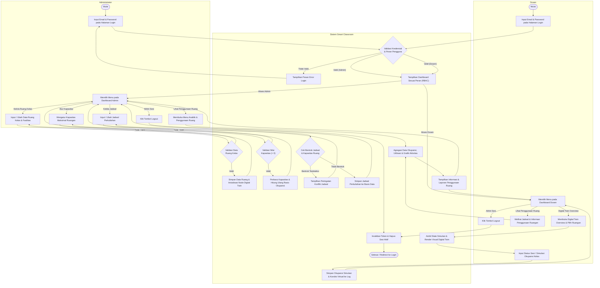

# Activity Diagram Documentation
## Smart Classroom Digital Twin System

Dokumen ini memodelkan alur aktivitas dan interaksi antara aktor pengguna dengan sistem pada **Smart Classroom Digital Twin System** menggunakan *Activity Diagram* berbasis *Swimlane* (Mermaid). Sesuai dengan spesifikasi perancangan Sprint 1, diagram berfokus pada tiga lajur interaksi utama: **Administrator**, **Dosen**, dan **Sistem Smart Classroom**.

> **Catatan Konsistensi Aktor:** Aktivitas pengelolaan ruang kelas dan pengaturan kapasitas yang dimodelkan pada lajur **Administrator** juga mencerminkan alur kerja operasional yang dapat dijalankan oleh aktor **Pengelola Fasilitas Kampus** sesuai pembagian hak akses pada `USER-STORY.md`.

---

## 1. Activity Diagram Terintegrasi (Swimlane)

Diagram berikut menggambarkan keseluruhan siklus aktivitas mulai dari login pengguna, pengelolaan data ruang kelas, pengaturan kapasitas ruangan, pengelolaan jadwal perkuliahan, pemantauan kondisi ruang kelas (*Digital Twin*), melihat informasi penggunaan ruang kelas, hingga logout.

---

## 2. Penjelasan Detail Setiap Aktivitas dan Alur Proses

### 2.1 Aktivitas Login Pengguna (`US-01`)
- **Aktor Terlibat:** Administrator, Dosen, Sistem Smart Classroom.
- **Alur Proses:**
  1. Pengguna (Administrator atau Dosen) membuka aplikasi web dan memasukkan *email* serta *password* pada formulir autentikasi.
  2. **Sistem Smart Classroom** memverifikasi kecocokan kredensial terhadap basis data pengguna serta memeriksa peran (*role*) yang dimiliki.
  3. Apabila kredensial tidak valid, sistem menampilkan pesan kesalahan dan meminta pengguna memasukkan ulang data login.
  4. Apabila valid, sistem menerbitkan *JSON Web Token* (JWT), memuat hak akses berbasis peran (RBAC), dan menampilkan halaman Dashboard utama.

### 2.2 Aktivitas Pengelolaan Data Ruang Kelas (`US-04`, `US-06`, `US-07`)
- **Aktor Terlibat:** Administrator, Sistem Smart Classroom.
- **Alur Proses:**
  1. Administrator memilih menu *Classroom Management* dari Dashboard.
  2. Administrator menginput data ruang kelas baru atau memperbarui data yang sudah ada (kode ruang, nama ruang, gedung, lantai, status operasional, dan daftar fasilitas virtual seperti proyektor atau AC).
  3. **Sistem Smart Classroom** memvalidasi kelengkapan atribut dan keunikan kode ruang.
  4. Jika valid, sistem menyimpan perubahan ke basis data serta secara otomatis membuat atau memperbarui entitas representasi *Digital Twin* ruang kelas tersebut.

### 2.3 Aktivitas Pengaturan Kapasitas Ruangan (`US-05`)
- **Aktor Terlibat:** Administrator, Sistem Smart Classroom.
- **Alur Proses:**
  1. Administrator memilih ruang kelas tertentu dan membuka fitur pengaturan kapasitas ruangan.
  2. Administrator menentukan nilai kapasitas maksimal kursi serta konfigurasi tata letak tempat duduk digital.
  3. **Sistem Smart Classroom** memvalidasi bahwa angka kapasitas merupakan bilangan bulat positif ($> 0$).
  4. Sistem menyimpan nilai kapasitas terbaru dan melakukan kalkulasi ulang terhadap persentase okupansi simulasi serta ambang batas peringatan jadwal untuk ruangan terkait.

### 2.4 Aktivitas Pengelolaan Jadwal Perkuliahan (`US-08`, `US-09`, `US-10`)
- **Aktor Terlibat:** Administrator, Sistem Smart Classroom.
- **Alur Proses:**
  1. Administrator membuka menu *Schedule Management* untuk menambahkan, mengubah, atau membatalkan jadwal perkuliahan.
  2. Administrator memilih mata kuliah, dosen pengampu, ruang kelas, hari, serta rentang jam mulai dan selesai.
  3. **Sistem Smart Classroom** menjalankan pemeriksaan konflik jadwal (*conflict detection*) untuk memastikan ruang kelas tidak berstatus *Maintenance* dan tidak ada irisan waktu pada ruangan maupun dosen yang sama.
  4. Jika terdeteksi bentrok, sistem menampilkan peringatan konflik agar Administrator menyesuaikan waktu atau ruangan. Jika bebas konflik, jadwal disimpan dan langsung dihubungkan dengan modul *Digital Twin Overview*.

### 2.5 Aktivitas Pemantauan Kondisi Ruang Kelas (`US-11`, `US-13`)
- **Aktor Terlibat:** Dosen, Sistem Smart Classroom.
- **Alur Proses:**
  1. Dosen memilih menu *Digital Twin Overview* untuk memantau kondisi ruang kelas secara visual.
  2. **Sistem Smart Classroom** mengambil status ruang kelas terkini (*Vacant*, *Occupied*, *Reserved*, *Maintenance*) dan merender representasi digital ruangan beserta informasi jadwal aktif dan kondisi perangkat virtual (suhu simulasi, status lampu, AC, dan proyektor).
  3. Untuk kelas yang sedang diampu, Dosen dapat memperbarui status pelaksanaan sesi perkuliahan serta jumlah peserta simulasi (*occupancy simulation*).
  4. Sistem memvalidasi input simulasi, menyimpannya ke dalam riwayat okupansi, dan memperbarui tampilan visual *Digital Twin* secara langsung.

### 2.6 Aktivitas Melihat Informasi Penggunaan Ruang Kelas (`US-12`, `US-14`)
- **Aktor Terlibat:** Administrator, Dosen, Sistem Smart Classroom.
- **Alur Proses:**
  1. Administrator maupun Dosen memilih menu laporan/informasi penggunaan ruang kelas atau membuka ringkasan analitik pada Dashboard.
  2. **Sistem Smart Classroom** melakukan agregasi data jadwal, log okupansi simulasi, dan kapasitas ruang kelas untuk menghitung metrik seperti tingkat utilisasi (%), okupansi rata-rata, dan distribusi jam sibuk.
  3. Sistem menampilkan hasil pengolahan dalam bentuk kartu KPI, tabel riwayat penggunaan ruangan, serta grafik analitik yang mudah dianalisis oleh pengguna.

### 2.7 Aktivitas Logout (`US-02`)
- **Aktor Terlibat:** Administrator, Dosen, Sistem Smart Classroom.
- **Alur Proses:**
  1. Setelah seluruh aktivitas selesai, Administrator atau Dosen menekan tombol *Logout* pada *sidebar* atau menu profil.
  2. **Sistem Smart Classroom** menginvalidasi token/sesi aktif pengguna, membersihkan status autentikasi pada peramban (*browser*), dan mengarahkan pengguna kembali ke halaman Login.
