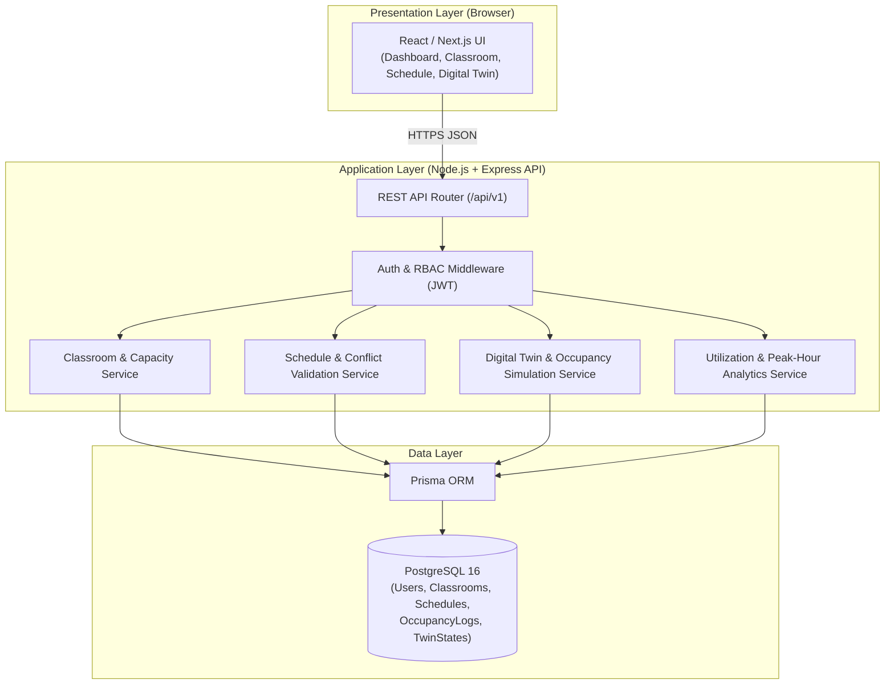
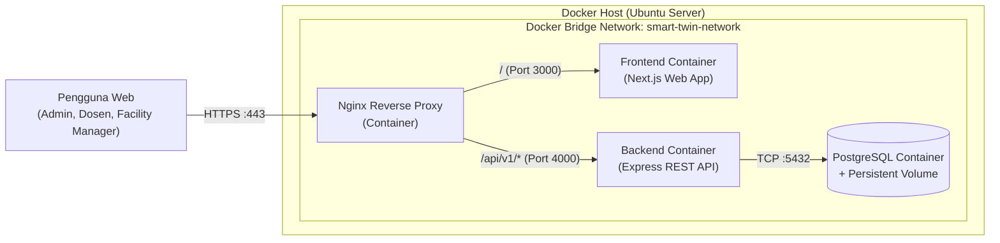
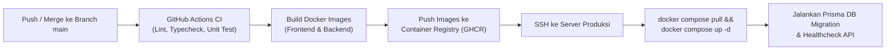

# System Deployment Architecture and Planning
## Smart Classroom Digital Twin System

Dokumen ini menjabarkan rancangan teknis infrastruktur, kebutuhan sistem, tumpukan teknologi (*technology stack*), arsitektur deployment, serta alur kerja pemasangan aplikasi **Smart Classroom Digital Twin System** berbasis web.

> **Batasan Deployment:** Sistem dideploy murni sebagai aplikasi web perangkat lunak (*software-only*) di lingkungan server kampus atau *cloud VPS*. Tidak terdapat konfigurasi *gateway* IoT, broker MQTT perangkat keras, ataupun integrasi sensor fisik.

---

## 1. System Requirements (Kebutuhan Perangkat Keras / VM Server)

Spesifikasi minimum dan rekomendasi untuk menjalankan seluruh *container* aplikasi (Frontend, Backend API, Reverse Proxy, dan Database) pada satu *Virtual Machine* (VM) Linux:

| Komponen | Spesifikasi Minimum (Staging/Demo) | Spesifikasi Rekomendasi (Produksi Kampus) |
| :--- | :--- | :--- |
| **CPU** | 2 vCPU | 4 vCPU |
| **RAM** | 4 GB | 8 GB |
| **Storage (SSD)** | 20 GB | 50 GB (termasuk ruang backup database) |
| **Jaringan** | 100 Mbps | 1 Gbps (akses HTTPS internal & publik kampus) |
| **Perangkat Klien** | PC/Laptop/Tablet dengan browser modern (Chrome, Firefox, Edge, Safari) | Resolusi layar minimal 1280×720 (desktop) atau responsif mobile |

---

## 2. Software Requirements

- **Sistem Operasi Server:** Ubuntu Server 22.04 LTS atau 24.04 LTS (64-bit)
- **Container Runtime:** Docker Engine (v24.x+) dan Docker Compose (v2.x+)
- **Web Server / Reverse Proxy:** Nginx (v1.24+) dengan sertifikat SSL/TLS (Let's Encrypt / SSL Kampus)
- **Runtime Pengembangan:** Node.js v20 LTS dan npm/pnpm
- **Database Management System:** PostgreSQL v16
- **Version Control & CI/CD:** Git dan GitHub Actions

---

## 3. Technology Stack

| Lapisan | Teknologi | Alasan Pemilihan |
| :--- | :--- | :--- |
| **Frontend Web** | React.js (Next.js / TypeScript) + Tailwind CSS | Mendukung antarmuka modern *Smart Campus* yang responsif, komponen modular, dan performa tinggi. |
| **Visualisasi & Grafik** | Recharts & SVG/Canvas 2D | Digunakan untuk grafik analitik utilisasi dan render denah visual *Digital Twin Overview*. |
| **Backend API** | Node.js + Express.js (TypeScript) | Ringan, skalabel, dan seragam menggunakan bahasa TypeScript antara frontend dan backend. |
| **ORM & Database** | Prisma ORM + PostgreSQL 16 | Menjamin integritas data relasional (ruang kelas, jadwal, validasi bentrok, serta log okupansi). |
| **Keamanan** | JWT (JSON Web Token) + bcrypt | Mendukung autentikasi *stateless* dan kontrol akses berbasis peran (RBAC). |
| **Containerization** | Docker & Docker Compose | Menjamin konsistensi lingkungan antara pengembangan lokal dan server produksi. |

---

## 4. Development Environment

Untuk menjaga keseragaman antar anggota tim pengembang mulai Sprint 2:
- **Code Editor:** Visual Studio Code dengan ekstensi ESLint, Prettier, Prisma, dan Tailwind CSS IntelliSense.
- **Lokal Database:** PostgreSQL dijalankan melalui `docker-compose.dev.yml`.
- **API Testing Tool:** Postman / Insomnia / Thunder Client berdasarkan kontrak pada `docs/API-SPEC.md`.
- **Branching Strategy:** Gitflow sederhana (`main` untuk rilis stabil, `develop` untuk integrasi sprint, `feature/*` untuk setiap *User Story*).

---

## 5. Application Architecture

Aplikasi menerapkan pola **Modular Layered Architecture** yang memisahkan lapisan presentasi (*Frontend*), lapisan logika bisnis (*Backend REST API*), dan lapisan persistensi data (*PostgreSQL*).



---

## 6. Deployment Architecture

Pada lingkungan produksi/staging, seluruh komponen dibungkus ke dalam *container* Docker yang terisolasi dalam jaringan internal (`smart-twin-network`), dengan **Nginx** sebagai satu-satunya pintu masuk publik melalui port `80/443`.



---

## 7. Installation Preparation

Langkah persiapan server sebelum melakukan deployment aplikasi pada Sprint berikutnya:
1. **Provisioning Server & Firewall:** Siapkan VM Ubuntu Server 22.04+, aktifkan UFW firewall dan hanya buka port `22` (SSH), `80` (HTTP redirect), dan `443` (HTTPS).
2. **Instalasi Docker & Compose:** Pasang Docker Engine dan Docker Compose plugin resmi serta pastikan user deployment tergabung dalam grup `docker`.
3. **Konfigurasi Domain & SSL:** Arahkan subdomain kampus (misalnya `smarttwin.campus.ac.id`) ke IP server dan siapkan sertifikat TLS menggunakan Certbot / Let's Encrypt.
4. **Penyiapan Direktori Persistent Volume:** Buat direktori khusus pada host untuk menyimpan volume data PostgreSQL agar data tidak hilang saat *container* dimulai ulang.

---

## 8. Deployment Workflow

Alur otomatisasi pembangunan (*build*) dan deployment menggunakan **GitHub Actions** dan **Docker Compose**:



### Tahapan Eksekusi Deployment
1. Pengembang menggabungkan kode terverifikasi ke branch `main`.
2. Pipeline CI menjalankan pemeriksaan kode (*linting*), uji otomatis, dan membangun *Docker image* produksi.
3. Server produksi menarik (*pull*) image terbaru, menjalankan pembaruan container tanpa downtime berarti (`docker compose up -d --remove-orphans`).
4. Skrip migrasi basis data (`npx prisma migrate deploy`) dijalankan untuk memastikan skema PostgreSQL sinkron dengan versi API terbaru.
5. Verifikasi *healthcheck* pada endpoint `/api/v1/health` dan pengujian akses halaman login melalui HTTPS.

---

## 9. Environment Configuration

Konfigurasi lingkungan disimpan menggunakan berkas `.env` yang **tidak di-commit ke repositori Git**. Berikut adalah template variabel lingkungan yang direncanakan:

### Backend Environment (`.env.backend`)
```env
NODE_ENV=production
PORT=4000
DATABASE_URL=postgresql://smarttwin_user:<SECURE_DB_PASSWORD>@postgres:5432/smarttwin_db?schema=public
JWT_SECRET=<RANDOM_256_BIT_SECRET_KEY>
JWT_EXPIRES_IN=1h
CORS_ORIGIN=https://smarttwin.campus.ac.id
SIMULATION_DEFAULT_TEMP_C=24.0
```

### Frontend Environment (`.env.frontend`)
```env
NEXT_PUBLIC_APP_NAME="Smart Classroom Digital Twin System"
NEXT_PUBLIC_API_BASE_URL=https://smarttwin.campus.ac.id/api/v1
```

### Database Container Environment (`.env.db`)
```env
POSTGRES_USER=smarttwin_user
POSTGRES_PASSWORD=<SECURE_DB_PASSWORD>
POSTGRES_DB=smarttwin_db
```
