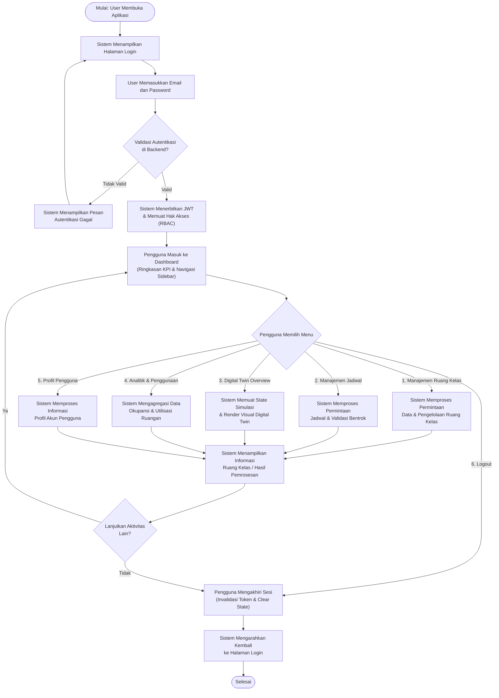
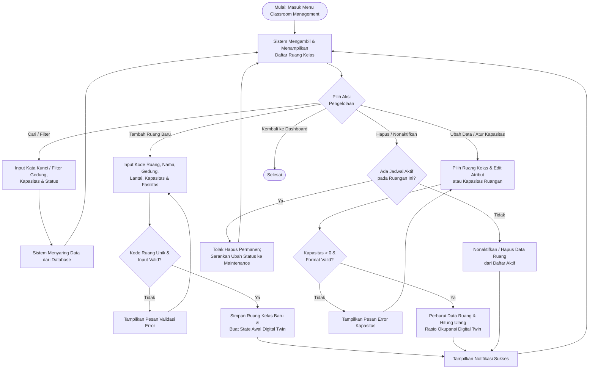

# System Flowchart Documentation
## Smart Classroom Digital Twin System

Dokumen ini menyajikan diagram alir (*Flowchart*) yang menggambarkan logika eksekusi utama **Smart Classroom Digital Twin System** dari sisi alur interaksi pengguna hingga pemrosesan di sisi sistem, serta diagram alir terpisah untuk proses pengelolaan ruang kelas.

---

## 1. Flowchart Alur Utama Sistem

Flowchart berikut memodelkan alur lengkap mulai dari pengguna membuka aplikasi, proses autentikasi, navigasi menu Dashboard, pemrosesan permintaan, penyajian informasi ruang kelas, hingga mengakhiri sesi (*logout*).

### Penjelasan Alur Utama Sistem
1. **Inisialisasi & Login:** Ketika pengguna mengakses URL aplikasi web, sistem memeriksa token sesi. Jika belum terautentikasi, sistem menampilkan halaman Login.
2. **Validasi Autentikasi:** Sistem mencocokkan kredensial pada layanan autentikasi. Jika gagal, pengguna menerima pesan kesalahan dan tetap berada di halaman Login. Jika berhasil, pengguna diarahkan ke **Dashboard**.
3. **Pemilihan Menu:** Melalui *sidebar navigation* pada Dashboard, pengguna memilih fitur sesuai hak aksesnya (Manajemen Ruang Kelas, Manajemen Jadwal, *Digital Twin Overview*, Analitik Penggunaan, atau Profil Pengguna).
4. **Pemrosesan & Tampilan Informasi:** Sistem menjalankan logika bisnis (pengambilan data, validasi, simulasi, atau agregasi analitik) melalui REST API dan menampilkan informasi ruang kelas atau hasil transaksi pada antarmuka pengguna.
5. **Pengakhiran Sesi:** Ketika pengguna memilih *Logout*, sistem membersihkan token autentikasi, mengakhiri sesi, dan mengembalikan tampilan ke halaman Login.

---

## 2. Flowchart Proses Pengelolaan Ruang Kelas (*Classroom Management*)

Flowchart terpisah ini menjelaskan secara rinci proses bisnis pada modul **Pengelolaan Ruang Kelas** yang digunakan oleh Administrator dan Pengelola Fasilitas Kampus (`US-04` sampai `US-07`).

### Penjelasan Alur Pengelolaan Ruang Kelas
1. **Pemuatan & Penyaringan Data:** Saat modul dibuka, sistem menampilkan daftar ruang kelas lengkap dengan informasi gedung, kapasitas, dan status operasional. Pengguna dapat melakukan pencarian atau penyaringan dinamis.
2. **Penambahan Ruang Kelas:** Sistem memvalidasi bahwa kode ruang belum digunakan dan seluruh kolom wajib terisi. Setelah tersimpan, sistem secara otomatis membuat representasi node *Digital Twin* awal dengan status standar *Vacant*.
3. **Pengubahan Data & Pengaturan Kapasitas:** Sistem memverifikasi agar nilai kapasitas bernilai positif sebelum memperbarui basis data dan menyesuaikan perhitungan persentase keterisian ruangan.
4. **Penghapusan/Penonaktifan Ruang Kelas:** Sistem memeriksa keterkaitan dengan jadwal perkuliahan aktif. Jika masih terdapat jadwal aktif, penghapusan diblokir untuk menjaga integritas data dan pengguna diarahkan mengubah status ruangan menjadi *Maintenance*.
