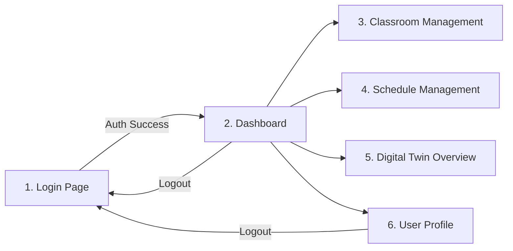

# UI/UX Design and Wireframe Documentation
## Smart Classroom Digital Twin System

Dokumen ini berisi rancangan antarmuka pengguna (*User Interface*) dan pengalaman pengguna (*User Experience*) untuk aplikasi web **Smart Classroom Digital Twin System**.

---

## 1. Konsep Desain Visual (*Modern Smart Campus*)

1. **Palet Warna Utama:**
   - **Navy Blue (`#0F172A` / `#1E3A8A`):** Warna dominan untuk *sidebar navigation*, *header accent*, dan tombol aksi utama guna memberikan kesan profesional, akademis, dan tepercaya.
   - **Pure White (`#FFFFFF`):** Latar belakang kartu konten (*dashboard cards*), tabel data, dan formulir agar keterbacaan (*readability*) tetap tinggi.
   - **Cool Gray (`#F1F5F9` / `#64748B`):** Latar belakang area kerja utama (*canvas*), garis pembatas (*borders*), serta teks sekunder.
   - **Status Accent Colors:** Hijau (`#10B981` – *Vacant/Available*), Biru (`#2563EB` – *Occupied/Active*), Kuning/Oranye (`#F59E0B` – *High Occupancy*), Abu-abu (`#94A3B8` – *Maintenance*).
2. **Pola Tata Letak (*Layout System*):**
   - Menggunakan struktur **Fixed Left Sidebar Navigation** (lebar `240px` pada desktop, berubah menjadi *collapsible drawer* pada perangkat seluler/tablet) + **Top Header Bar** + **Responsive Content Grid**.
   - Menggunakan **Dashboard Cards** dengan sudut membulat (*rounded corners*), bayangan halus (*subtle shadow*), dan tipografi modern *sans-serif* (*Inter*).

---

## 2. Peta Navigasi Aplikasi



---

## 3. Rancangan Halaman

### 3.1 Login Page

- **Tujuan Halaman:** Memverifikasi identitas pengguna (*Administrator*, *Dosen*, atau *Pengelola Fasilitas Kampus*) sebelum memberikan akses ke sistem sesuai peran masing-masing.
- **Deskripsi Komponen:**
  - *Split-screen card* di tengah layar: panel kiri menampilkan identitas visual *Smart Campus* dan deskripsi singkat **Smart Classroom Digital Twin System** (berlatar *Navy Blue*), panel kanan berisi formulir login (berlatar putih).
  - Input field *Email Kampus*, input field *Password* (dengan ikon *show/hide password*), tombol utama *"Sign In"*, dan area notifikasi pesan kesalahan validasi.
- **Layout:** *Centered Split-Card Layout* responsif (pada layar mobile, panel kiri diringkas menjadi logo header di atas form).
- **Navigasi:** Pengguna belum terautentikasi hanya dapat mengakses halaman ini. Setelah berhasil login, sistem mengarahkan ke halaman **Dashboard**.
- **Penjelasan Interaksi Pengguna:** Pengguna mengisi email dan kata sandi lalu menekan tombol *"Sign In"*. Tombol menampilkan indikator *loading* saat sistem memvalidasi kredensial ke API `/api/v1/auth/login`. Jika gagal, pesan error berwarna merah muncul di atas form.
- **Wireframe:**

```text
+-----------------------------------------------------------------------+
|                       SMART CLASSROOM DIGITAL TWIN                    |
|                                                                       |
|   +-------------------------------+-------------------------------+   |
|   | [NAVY BLUE PANEL]             | [WHITE PANEL]                 |   |
|   |                               |                               |   |
|   |  [Logo Smart Campus]          |  Selamat Datang               |   |
|   |                               |  Masuk ke akun kampus Anda    |   |
|   |  Smart Classroom              |                               |   |
|   |  Digital Twin System          |  Email Kampus                 |   |
|   |                               |  [ nama@campus.ac.id        ] |   |
|   |  "Digital representation,     |                               |   |
|   |   scheduling & occupancy      |  Password                     |   |
|   |   analytics for modern        |  [ •••••••••••••••     (eye)] |   |
|   |   university classrooms."     |                               |   |
|   |                               |  [       Sign In (Navy)     ] |   |
|   |                               |                               |   |
|   |                               |  *Error message area if any   |   |
|   +-------------------------------+-------------------------------+   |
+-----------------------------------------------------------------------+
```

---

### 3.2 Dashboard

- **Tujuan Halaman:** Memberikan ringkasan eksekutif secara cepat mengenai kondisi ruang kelas, tingkat okupansi terkini, jadwal hari ini, serta grafik analitik utilisasi kampus.
- **Deskripsi Komponen:**
  - **Sidebar Navigation (Navy Blue):** Logo sistem dan menu (*Dashboard*, *Digital Twin Overview*, *Classroom Management*, *Schedule Management*, *User Profile*, *Logout*).
  - **Top Header Bar:** Judul halaman, filter gedung/periode, serta avatar & nama pengguna aktif.
  - **4 KPI Summary Cards:** (1) Total Ruang Kelas, (2) Ruang Aktif Terpakai, (3) Rata-rata Okupansi (%), (4) Total Sesi Kuliah Hari Ini.
  - **Charts Section:** Grafik Batang *Utilisasi Ruang per Gedung* dan Grafik Garis *Tren Jam Sibuk Perkuliahan (Peak Hours)*.
  - **Live Activity Table Card:** Daftar ringkas kelas yang sedang berlangsung beserta persentase okupansi simulasi.
- **Layout:** *Grid 12-kolom* responsif: 4 kartu KPI sejajar (`3 col` per kartu pada desktop, `2x2` pada tablet, `1 col` pada mobile), diikuti 2 grafik berdampingan (`6 col` + `6 col`), dan tabel aktivitas di bagian bawah (`12 col`).
- **Navigasi:** Menjadi halaman pendaratan utama setelah login. Mengklik kartu ruang pada tabel aktivitas dapat langsung menuju detail pada *Digital Twin Overview*.
- **Penjelasan Interaksi Pengguna:** Pengguna dapat mengubah filter gedung atau rentang waktu (*Weekly/Monthly*) pada sudut kanan atas area grafik untuk memperbarui visualisasi analitik secara dinamis, serta mengarahkan kursor (*hover*) pada grafik untuk melihat *tooltip* angka detail.
- **Wireframe:**

```text
+------------------+----------------------------------------------------+
| [SIDEBAR - NAVY] | [TOP BAR] Dashboard           [Filter: Semua Gedung]|
|                  |                                  [User Avatar v]    |
|  Smart Twin      +----------------------------------------------------+
|  --------------  | +------------+ +------------+ +--------+ +-------+ |
| > Dashboard      | | Total Room | | Occupied   | | Avg    | | Today | |
|   Digital Twin   | |     24     | |     12     | | 74.5%  | |  38   | |
|   Classrooms     | +------------+ +------------+ +--------+ +-------+ |
|   Schedules      |                                                    |
|   Profile        | +-----------------------+ +----------------------+ |
|                  | | Utilisasi per Gedung  | | Peak Hours Trend     | |
|                  | | [||||  ] Gedung A 82% | |    /\    /\          | |
|                  | | [|||   ] Gedung B 68% | |   /  \__/  \         | |
|                  | | [||    ] Gedung C 54% | |  08  10  13  15      | |
|                  | +-----------------------+ +----------------------+ |
|                  |                                                    |
|                  | +------------------------------------------------+ |
|                  | | Aktivitas Perkuliahan Terkini                  | |
|                  | | Ruang     | Mata Kuliah    | Okupansi | Status | |
|                  | | GD-A-301  | RPL (IF302)    | 52/60    | [OCC]  | |
| [Logout]         | | GD-B-204  | Basis Data     | 0/45     | [VAC]  | |
+------------------+----------------------------------------------------+
```

---

### 3.3 Classroom Management

- **Tujuan Halaman:** Memfasilitasi Administrator dan Pengelola Fasilitas Kampus dalam melihat, mencari, menambah, mengubah data ruang kelas, serta mengatur kapasitas maksimal dan status operasional ruangan.
- **Deskripsi Komponen:**
  - **Action & Filter Toolbar:** Kolom pencarian teks, *dropdown* filter Gedung, filter Status (*Available*, *Maintenance*, *Inactive*), filter Kapasitas Minimum, dan tombol utama *"+ Tambah Ruang Kelas"*.
  - **Classroom Data Table:** Menampilkan Kode Ruang, Nama Ruang, Gedung/Lantai, Kapasitas, Ikon Fasilitas, Status Badge, dan Tombol Aksi (*Edit*, *Atur Kapasitas*, *Hapus/Nonaktifkan*).
  - **Modal Dialog Form:** Formulir *overlay* untuk tambah/ubah ruang kelas dan modal khusus pengaturan cepat kapasitas kursi.
- **Layout:** *Toolbar* horizontal di bagian atas, tabel penuh (*full-width card*) di tengah, dan *pagination bar* di bagian bawah tabel.
- **Navigasi:** Diakses melalui menu *Classrooms* di *sidebar*. Pengguna dengan peran `DOSEN` hanya melihat mode baca (*read-only*) tanpa tombol tambah/ubah/hapus.
- **Penjelasan Interaksi Pengguna:** Klik tombol *"+ Tambah Ruang Kelas"* membuka modal input. Klik ikon *"Atur Kapasitas"* pada baris tabel membuka modal kecil untuk memperbarui angka kapasitas secara cepat tanpa harus mengedit seluruh atribut ruang.
- **Wireframe:**

```text
+------------------+----------------------------------------------------+
| [SIDEBAR - NAVY] | [TOP BAR] Classroom Management      [User Avatar]  |
|                  +----------------------------------------------------+
|   Dashboard      | [Search Kode/Nama...] [Gedung v] [Status v]        |
|   Digital Twin   |                              [+ Tambah Ruang Kelas]|
| > Classrooms     +----------------------------------------------------+
|   Schedules      | +------------------------------------------------+ |
|   Profile        | | Kode     | Nama         | Gedung | Kap. | Status | |
|                  | |----------|--------------|--------|------|--------| |
|                  | | GD-A-301 | Ruang A301   | Gd. A  |  60  | [AVAIL]| |
|                  | |          | Fasilitas: [Proj][AC]   [Edit][Cap][X]| |
|                  | |----------|--------------|--------|------|--------| |
|                  | | GD-B-204 | Ruang B204   | Gd. B  |  45  | [MAINT]| |
|                  | |          | Fasilitas: [Proj][AC]   [Edit][Cap][X]| |
|                  | +------------------------------------------------+ |
|                  |                 Showing 1-10 of 24   [< 1 2 3 >]   |
+------------------+----------------------------------------------------+
```

---

### 3.4 Schedule Management

- **Tujuan Halaman:** Mengelola jadwal perkuliahan per ruang kelas dengan validasi pencegahan bentrok jadwal dan keterlihatan jadwal untuk seluruh aktor.
- **Deskripsi Komponen:**
  - **Schedule Filter Bar:** Filter berdasarkan Hari (*Senin–Sabtu*), Ruang Kelas, atau Dosen Pengampu, serta tombol *"+ Buat Jadwal Baru"* (khusus Administrator).
  - **Schedule View Switcher:** Pilihan tampilan *Table View* atau *Weekly Room Grid View*.
  - **Schedule Table / Grid:** Menampilkan Hari, Jam Mulai–Selesai, Kode & Nama Mata Kuliah, Ruang Kelas, Dosen Pengampu, Perkiraan Mahasiswa, dan Tombol Aksi (*Edit*, *Hapus*).
  - **Conflict Alert Banner (dalam Modal):** Peringatan otomatis berwarna merah/oranye apabila ruang atau dosen mengalami bentrok waktu saat pengisian form.
- **Layout:** *Filter toolbar* di atas, kontainer tabel/jadwal mingguan di area utama.
- **Navigasi:** Diakses melalui menu *Schedules* di *sidebar*. Dosen dapat mengklik tombol *"Jadwal Saya"* untuk menyaring jadwal yang diampunya saja.
- **Penjelasan Interaksi Pengguna:** Administrator mengklik *"+ Buat Jadwal Baru"*, memilih ruang dan slot waktu; sistem langsung memvalidasi ketersediaan slot sebelum tombol *"Simpan Jadwal"* diaktifkan.
- **Wireframe:**

```text
+------------------+----------------------------------------------------+
| [SIDEBAR - NAVY] | [TOP BAR] Schedule Management       [User Avatar]  |
|                  +----------------------------------------------------+
|   Dashboard      | [Filter Hari v] [Filter Ruang v] [ ] Jadwal Saya   |
|   Digital Twin   |                                 [+ Buat Jadwal Baru]|
|   Classrooms     +----------------------------------------------------+
| > Schedules      | [ View: Table | Weekly Grid ]                      |
|   Profile        | +------------------------------------------------+ |
|                  | | Hari   | Jam         | Ruang    | Mata Kuliah    | |
|                  | |--------|-------------|----------|----------------| |
|                  | | Senin  | 08:00-10:30 | GD-A-301 | IF302 - RPL    | |
|                  | |        | Dosen: Prof. Siti | Mhs: 48 | [Edit][X] | |
|                  | |--------|-------------|----------|----------------| |
|                  | | Selasa | 13:00-15:30 | GD-A-301 | IF405 - Arsit. | |
|                  | |        | Dosen: Prof. Siti | Mhs: 50 | [Edit][X] | |
|                  | +------------------------------------------------+ |
+------------------+----------------------------------------------------+
```

---

### 3.5 Digital Twin Overview

- **Tujuan Halaman:** Menyajikan representasi digital ruang kelas (*Digital Twin*) secara visual dan interaktif untuk memantau kondisi ruangan, status okupansi simulasi, jadwal berlangsung, serta mengontrol parameter simulasi kondisi virtual tanpa sensor fisik.
- **Deskripsi Komponen:**
  - **Building & Floor Selector Tabs:** Navigasi cepat memilih gedung dan lantai kampus.
  - **Status Legend Bar:** Indikator warna status (*Hijau = Vacant*, *Biru = Occupied*, *Abu-abu = Maintenance*).
  - **Interactive Classroom Twin Grid (Panel Kiri/Utama):** Kartu visual tiap ruangan yang menampilkan kode ruang, *progress bar* okupansi (`52/60`), mata kuliah aktif, dan ikon status perangkat virtual (AC, Lampu, Proyektor).
  - **Digital Twin Inspector Drawer / Panel Kanan:** Panel detail ruangan yang dipilih, memuat denah/grid kursi simulasi 2D, suhu simulasi (`23.5°C`), kontrol *toggle* perangkat virtual, dan form input simulasi jumlah okupansi terkini.
- **Layout:** *Split Master-Detail Layout* (`7 col` grid ruangan interaktif + `5 col` panel inspeksi detail Digital Twin di kanan; pada layar mobile panel inspeksi tampil sebagai *bottom sheet/modal*).
- **Navigasi:** Diakses dari menu *Digital Twin* di *sidebar* atau langsung dari *Dashboard*.
- **Penjelasan Interaksi Pengguna:** Pengguna mengklik salah satu kartu ruangan pada grid (misalnya `GD-A-301`). Panel inspeksi di sebelah kanan langsung memperbarui tampilan denah kursi 2D dan jadwal aktif ruangan tersebut. Dosen/Admin/Pengelola Fasilitas dapat mengubah jumlah okupansi simulasi atau *toggle* status AC/Lampu/Proyektor lalu menekan *"Update Twin State"* untuk menyimpannya.
- **Wireframe:**

```text
+------------------+----------------------------------------------------+
| [SIDEBAR - NAVY] | [TOP BAR] Digital Twin Overview     [User Avatar]  |
|                  +----------------------------------------------------+
|   Dashboard      | Gedung: [Gedung A v]  Lantai: [Semua] [Lt.1] [Lt.3]|
| > Digital Twin   | Legend: (•) Vacant  (•) Occupied  (•) Maintenance  |
|   Classrooms     +------------------------------+---------------------+
|   Schedules      | [ROOM TWIN GRID]             | [INSPECTOR PANEL]   |
|   Profile        | +------------+ +-----------+ | GD-A-301 (Occupied) |
|                  | | GD-A-301   | | GD-A-302  | | RPL - Prof. Siti    |
|                  | | [OCCUPIED] | | [VACANT]  | |                     |
|                  | | 52/60 (87%)| | 0/50 (0%) | | [2D Seat Map Sim]   |
|                  | | AC:ON L:ON | | AC:OFF    | | [■ ■ ■ ■ ■ ■ ■ ■ □ □] |
|                  | +------------+ +-----------+ | [■ ■ ■ ■ ■ ■ ■ ■ □ □] |
|                  | +------------+ +-----------+ |                     |
|                  | | GD-A-303   | | GD-A-304  | | Virtual Environment |
|                  | | [MAINT]    | | [OCCUPIED]| | Temp Sim: [23.5 °C] |
|                  | | Perawatan  | | 38/40(95%)| | AC:[ON] Lampu:[ON]  |
|                  | +------------+ +-----------+ | Proyektor:[ON]      |
|                  |                              | Okupansi: [ 52 ]    |
|                  |                              | [Update Twin State] |
+------------------+----------------------------------------------------+
```

---

### 3.6 User Profile

- **Tujuan Halaman:** Menampilkan informasi akun pengguna yang sedang aktif serta menyediakan fitur pembaruan data profil dan kata sandi.
- **Deskripsi Komponen:**
  - **Profile Header Card:** Avatar inisial pengguna, nama lengkap, email kampus, dan lencana peran (*Role Badge*: `ADMIN` / `DOSEN` / `FACILITY_MANAGER`).
  - **Edit Profile Form Card:** Input Nama Lengkap, Unit/Fakultas, Nomor Telepon, dan tombol *"Simpan Perubahan"*.
  - **Security Card:** Formulir ubah kata sandi (*Password Lama*, *Password Baru*, *Konfirmasi Password Baru*) serta tombol *"Logout dari Sesi"*.
- **Layout:** Kontainer terpusat (*max-width 800px*) dengan kartu bertumpuk secara vertikal (*stacked cards*).
- **Navigasi:** Diakses melalui menu *Profile* di *sidebar* atau klik avatar di *top bar*.
- **Penjelasan Interaksi Pengguna:** Pengguna memperbarui detail kontak atau kata sandi lalu menekan tombol simpan; sistem memvalidasi masukan dan menampilkan notifikasi *toast* konfirmasi.
- **Wireframe:**

```text
+------------------+----------------------------------------------------+
| [SIDEBAR - NAVY] | [TOP BAR] User Profile              [User Avatar]  |
|                  +----------------------------------------------------+
|   Dashboard      |   +--------------------------------------------+   |
|   Digital Twin   |   | [Avatar]  Prof. Siti Aminah, M.Kom.        |   |
|   Classrooms     |   |           siti.aminah@campus.ac.id         |   |
|   Schedules      |   |           Role: [ DOSEN ]                  |   |
| > Profile        |   +--------------------------------------------+   |
|                  |                                                    |
|                  |   +--------------------------------------------+   |
|                  |   | Informasi Pribadi                          |   |
|                  |   | Nama Lengkap : [ Prof. Siti Aminah       ] |   |
|                  |   | Departemen   : [ Teknik Informatika      ] |   |
|                  |   | No. Telepon  : [ 081234567890            ] |   |
|                  |   |                    [ Simpan Perubahan ]    |   |
|                  |   +--------------------------------------------+   |
|                  |                                                    |
|                  |   +--------------------------------------------+   |
|                  |   | Keamanan Akun                              |   |
|                  |   | Password Lama : [ ••••••••• ]              |   |
|                  |   | Password Baru : [ ••••••••• ]              |   |
|                  |   |                  [ Perbarui Password ]     |   |
|                  |   +--------------------------------------------+   |
+------------------+----------------------------------------------------+
```
